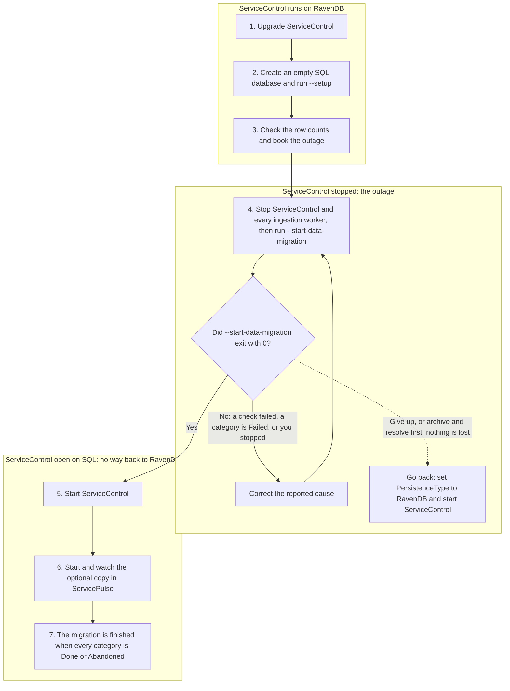

# Migration Engine: Instructions

This page tells you how to move the data of a ServiceControl error instance from RavenDB to SQL Server or PostgreSQL. The ServiceControl executable provides the offline command and the online copier, so you do not need a separate tool. [The migration overview](ravendb-to-sql-migration-overview.md) explains how the migration works and why.

The migration does not move the audit instance or the monitoring instance. The audit instance has no migration path and the monitoring instance keeps its data in memory, so it has nothing to move.

## How the migration runs

Run `--start-data-migration` with ServiceControl stopped to copy the data it needs to open. **This part is your outage**. After the command succeeds, start ServiceControl to copy the event log and the archived and resolved failed messages in the background. **The migration never writes to RavenDB**.

> [!IMPORTANT]
> Until ServiceControl opens, you can go back to RavenDB and lose nothing. After it opens, you cannot go back.

The migration copies the data in categories, and each category is Copying, Done, Failed or Abandoned. [The overview](ravendb-to-sql-migration-overview.md#when-something-goes-wrong-you-decide-what-happens-next) explains the categories and the states.

The steps below follow this path:



## Before you start

Make sure that your setup is supported:

- The RavenDB source is one of these:
  - embedded on the host (Windows installation only)
  - self-hosted on your network, or RavenDB Cloud
- The primary database and the throughput database of RavenDB are on the same server or cluster.
- The SQL target is SQL Server or PostgreSQL.
- A SQL Server target has Full-Text Search installed. Message search needs it, so `--setup` fails without it. The stock SQL Server container image does not have it. PostgreSQL needs nothing extra.
- The ServiceControl host can connect to RavenDB, to the SQL database, and to the message body storage at the same time.
- If ServiceControl runs in a container, RavenDB is an external server. The container image does not contain the RavenDB server, so it cannot open an embedded database.

Get the data ready:

- Resolve or archive as many unresolved failed messages as you can. They never age out, and ServiceControl stays closed until they are all copied. **A large backlog makes the outage long**. Above 50,000 unresolved failed messages, the migration warns you and advises you to archive or resolve them first, see [step 4](#step-4-run-the-offline-command). The copy reads archived and resolved messages only after ServiceControl opens, when you start that copy in ServicePulse. The exception is a RavenDB index that is broken or leaves out some failed messages: then the copy reads every failed message during the outage, logs a warning, and a large archive makes the outage longer too.
- Run `--import-failed-errors` while the instance is still on RavenDB. A failed error import is a message that ServiceControl took off the error queue but failed to store. The migration copies these either way, but imported ones arrive as ordinary failed messages.
- Back up both RavenDB databases before step 4, because RavenDB is your only way back if the migration fails. If you do not back them up, disable expiration on the primary database after ServiceControl last runs on RavenDB, because every start on RavenDB turns it back on.

Keep these settings as they are:

- Keep `ServiceControl/RetryHistoryDepth` above 0. If it is 0 or less, the migration refuses to start. At that value, the first completed retry after the move deletes all the copied retry history.
- Do not change `ServiceControl/ErrorRetentionPeriod` or `ServiceControl/EventRetentionPeriod` until the migration is finished. The migration uses them to decide which rows are too old to copy.

## Keep the RavenDB settings

The migration reads RavenDB through the RavenDB settings that the instance already has. You do not add new settings for the source. Keep these settings in the configuration of the instance, also after you change `ServiceControl/PersistenceType` to SQL Server or PostgreSQL.

| Setting | Environment variable | What it is |
| --- | --- | --- |
| `ServiceControl/RavenDB/ConnectionString` | `SERVICECONTROL_RAVENDB_CONNECTIONSTRING` | The address of an external RavenDB server. Leave it unset for an embedded database. |
| `ServiceControl/DbPath` | `SERVICECONTROL_DBPATH` | The data directory of the embedded database. |
| `ServiceControl/RavenDB/DatabaseName` | `SERVICECONTROL_RAVENDB_DATABASENAME` | The primary database. The default is `primary`. |
| `LicensingComponent/RavenDB/ThroughputDatabaseName` | `LICENSINGCOMPONENT_RAVENDB_THROUGHPUTDATABASENAME` | The throughput database. The default is `throughput`. |
| `ServiceControl/RavenDB/ClientCertificatePath` or `ServiceControl/RavenDB/ClientCertificateBase64`, with `ServiceControl/RavenDB/ClientCertificatePassword` | `SERVICECONTROL_RAVENDB_CLIENTCERTIFICATEPATH` and so on | The client certificate for a secured external server. |
| `ServiceControl/ErrorRetentionPeriod` | `SERVICECONTROL_ERRORRETENTIONPERIOD` | Required. ServiceControl does not start without it. |

In an environment variable, you can leave out the `SERVICECONTROL_` prefix. You cannot leave out the `LICENSINGCOMPONENT_` prefix.

## Step 1: Upgrade ServiceControl

> [!IMPORTANT]
>
> - Upgrade the instance to the latest version in the usual way, and keep it on RavenDB. The version that copies the data must be the version that last ran against RavenDB.
> - Do not start ServiceControl on the new SQL database until step 5. If ServiceControl starts on the new database before `--start-data-migration`, it writes rows to the database, and the migration then refuses that database. If this happens, start again from a new, empty database.
> - Do not run ServiceControl on RavenDB again between two runs of the copy, because rows that change there after they were copied are not copied again.

## Step 2: Create an empty SQL database

1. Create a new database on SQL Server or PostgreSQL.
2. In the configuration of the instance, set `ServiceControl/PersistenceType` to `SQLServer` or `PostgreSQL`.
3. Set `ServiceControl/Database/ConnectionString` to the new database.
4. Set `ServiceControl/MessageBody/StorageType` to `FileSystem`, `AzureBlob` or `S3`, and set the settings for that storage type. Give the message body storage at least as much free space as the RavenDB primary database uses on disk today. RavenDB keeps the bodies inside that database, so its size is more than the copy will write.
5. Run `ServiceControl.exe --setup`. This creates the SQL schema, which includes the table where the migration saves its progress.

## Step 3: Check the row counts

Run the offline command once before the outage, and answer no at "Start the copy?". It shows the configuration, runs the checks and counts the rows of each required category, but writes nothing to SQL. The only write is a test body that the body storage check writes and deletes. You can use the same SQL database afterwards.

1. Stop ServiceControl and every ingestion worker. The command reads RavenDB with ServiceControl stopped, and on an embedded source only one process can use the data directory.
2. Run `ServiceControl.exe --start-data-migration`, as in [step 4](#step-4-run-the-offline-command).
3. Answer `n` at "Start the copy?". If the run shows [the warning about unresolved failed messages](#more-than-50000-unresolved-failed-messages), answer `s` to stop.
4. Set `ServiceControl/PersistenceType` back to RavenDB, and start ServiceControl. Set it to `SQLServer` or `PostgreSQL` again before step 4.

Use the row counts of the required categories to plan the outage. The unresolved failed messages are usually most of it. If there are more than 50,000, archive or resolve the ones you do not need in ServicePulse before the outage.

## Step 4: Run the offline command

1. Stop ServiceControl and every ingestion worker.
2. Run `ServiceControl.exe --start-data-migration` from the instance installation folder. In a container deployment, run the command in a [one-off container](#run-a-command-in-a-container) against the same databases.
3. Answer its questions. The command numbers its steps, and shows only the steps that apply to this run:
   - First it asks you to confirm that ServiceControl and every ingestion worker are stopped.
   - **Configuration**: it shows every value the migration uses and where each came from, with passwords masked, and asks "Is this correct?".
   - **Checks**: it runs the startup checks and shows `[ok]`, `[FAIL]` or `[skip]` for each. The first `[FAIL]` stops the run.
   - **Rows to copy**: it counts the rows of each required category that is not finished. On a first run above 50,000 unresolved failed messages it shows [a warning](#more-than-50000-unresolved-failed-messages).
   - **Start the copy**: it asks "Start the copy?". Nothing is copied before you answer yes.
   - **Copying required data**: it copies each required category and shows its progress. When the copy ends, it lists the skipped rows: each row skipped as a fault with its id and reason, and the harmless skips as a count. The log file of the run also has a warning for every skipped row, harmless skips included, with its id, reason and detail, unless the log level is above Warning. In a container the log goes to the console, so keep the console output.
   - **Failed categories**: if a required category is Failed, it asks you to retry it, abandon it or stop, see [A category is Failed](#a-category-is-failed).
   - **Verify**: it compares the RavenDB counts from the rows step with the rows the copy read. It judges only the required categories. The command sets nothing for the optional categories, and ServicePulse shows them.
4. If the command fails or you stop it, correct the reported cause. Run `--start-data-migration` again to resume. The next run continues from where the migration is, and skips the steps that no longer apply.

The command exits without starting ServiceControl. It exits with 0 when the required data is copied and verify is clean. Then start ServiceControl. It exits with 1 when you answer no or stop, a check fails, a category is Failed, or the run is cancelled. It exits with 2 when nothing is outstanding but verify found rows that the copy did not read.

Outside a container, the command logs to its own file for each run, named `migration-<yyyy-MM-dd-HHmmss>.txt`, in the log folder of the instance next to `logfile.txt`. A run started in the same second as the one before adds to its file. The console shows only the steps. When the run ends, it names its log file. An argument the command refuses prints the reason and names no log file. In a container, the log goes to the console.

### More than 50,000 unresolved failed messages

Copying a large backlog makes the outage long. Above 50,000 unresolved failed messages, a first run shows a warning below the counts. It advises you to archive or resolve them first:

1. Set `ServiceControl/PersistenceType` back to RavenDB, then start ServiceControl.
2. In ServicePulse, archive or resolve the failed messages you do not need. Archived and resolved messages are not copied during the outage.
3. Stop ServiceControl, set `ServiceControl/PersistenceType` back to `SQLServer` or `PostgreSQL`, and run `--start-data-migration` again.

Then it asks you to choose:

- `s`: stop. Nothing has been written, so you can go back to RavenDB and use the same SQL database later.
- `c`: continue and copy them all.
- `a`: abandon `UnresolvedAndRetryIssuedFailedMessages`. These messages stay only in RavenDB. Once ServiceControl starts on SQL you cannot retry, archive or view them, and they cannot be copied later. Type `ABANDON` to confirm. The abandon is saved when the copy starts.

The limit of 50,000 is fixed. A resumed run shows no warning and keeps the answer the first run gave. It still abandons the category when you pass `--abandon=UnresolvedAndRetryIssuedFailedMessages` before its copy starts. Without a console, the run stops at the warning with exit code 1, unless you pass `--abandon=UnresolvedAndRetryIssuedFailedMessages`. No argument continues past it.

## Step 5: Start ServiceControl

After the offline command exits with 0, start the ServiceControl service or container. ServiceControl detects the migration from SQL checkpoints. It copies no optional data until you start it in ServicePulse.

Normal startup refuses an unfinished required copy and tells you to run `--start-data-migration`; it never resumes that copy itself.

> [!IMPORTANT]
> Do not start any `--error-ingestion-only` worker until the offline command succeeds and the main ServiceControl instance opens. A worker cannot detect a migration before its first checkpoint exists.

If something goes wrong, read [If something goes wrong](#if-something-goes-wrong).

## Step 6: Copy the optional data in ServicePulse

Two optional categories, the event log and the archived and resolved failed messages, copy in the background after ServiceControl opens. Start each one in ServicePulse, and choose its window there: how many days back it copies. By default the window is the retention period of the instance, so everything RavenDB still holds is copied. A window longer than the retention period copies nothing extra. If you do not want a category, abandon it in ServicePulse.

ServiceControl is open and works as usual while the optional categories copy. You can see the progress in three places:

- The ServiceControl log.
- The ServicePulse activity feed. It shows when a category fails and when RavenDB cannot be reached.
- The output of `--migration-status`. This command does not open RavenDB, so you can run it at any time.

If the copy slows down your production work, pause the category in ServicePulse and resume it later. Or raise `ServiceControl/Migration/ThrottlePauseMilliseconds` and restart. This is the pause between two background batches. The default is 100 milliseconds.

> [!IMPORTANT]
> Retry or abandon a Failed optional category in ServicePulse. No command does it. Until you do, it stays Failed, and `--migration-status` shows it.

Keep RavenDB running until every category is Done or Abandoned. If RavenDB goes down after ServiceControl opens, ServiceControl keeps running. The optional categories wait for RavenDB to come back.

## Step 7: Finish the migration

The migration is finished when every category is Done or Abandoned. ServicePulse and `--migration-status` show it. Finished checkpoints remain in SQL, but no background copy runs and RavenDB is not opened.

To check the required data again, stop ServiceControl and run `--start-data-migration`. Every required category is Done or Abandoned, so it shows the configuration, runs the checks and verifies. Then start ServiceControl.

Verify checks the required categories only. It counts the rows in RavenDB again, and compares them with the rows that the copy read. It also shows the skipped rows by reason, and the rows that each abandoned category did not read.

Merged and changed rows are not shown here. Each one is logged as a warning by the copy run that merged or changed it, and that run's summary counts them.

Verify sets the exit code:

- 1 while a required category is Failed or still copying, and when the run cannot read the checkpoints.
- 2 when nothing is outstanding but rows were not read, so read the report before you remove RavenDB. It is also 2 when the run cannot open RavenDB, and then it does not verify.
- 0 otherwise. Skipped and abandoned rows are listed but do not change the exit code.

Verify reads all the data in RavenDB again, but not the message bodies. On a large instance this takes time, and ServiceControl is stopped during that time.

If verify shows rows that the copy did not read, keep RavenDB. Those rows are only in RavenDB. RavenDB can show fewer rows than the copy read when nothing is wrong, because RavenDB deletes old rows. [The overview](ravendb-to-sql-migration-overview.md#the-offline-command) explains why.

No configuration change is needed to finish. Once every category is Done or Abandoned, subsequent starts leave RavenDB unopened.

## If something goes wrong

### A startup check fails

The offline command shows `[FAIL]` next to the check, prints why it failed, and stops. Nothing is copied. Correct the cause, then run `--start-data-migration` again. Before the copy has started, you can test your correction and answer no at "Start the copy?".

### A category is Failed

A category becomes Failed when it cannot copy rows, or when an error stops it. The rows that it already copied stay in SQL. A restart does not change a Failed category.

When a required category is Failed, the offline command shows it with its reason and asks you to choose:

- `r`: retry it now. The run copies the category again from the start.
- `a`: abandon it.
- `s`: stop. The run exits with 1. When you run `--start-data-migration` again, it comes back to this choice.

Without a console, pass `--retry=<category>` or `--abandon=<category>`. If neither names the Failed category, the run stops with exit code 1. Each `--retry` is used once per run, so a category that fails again stops the run.

These choices cover the required categories only. Retry or abandon an optional category in ServicePulse.

#### To retry a category

1. Read why the category failed. The run shows the reason with the skip reasons, and lists the rows it skipped as faults when the copy ends. `--migration-status` shows the skip count and any error, but not the skip reasons.
2. Correct the cause. It is usually outside the migration, for example the body storage cannot be reached, a certificate expired, a database is down, or a disk is full.
3. Answer `r`. You can also stop, correct the cause, and run `--start-data-migration` again.

An optional category that an error left copying is not Failed and needs no retry. It resumes by itself on the next start.

#### To abandon a category

1. Answer `a`.
2. Read the warning. When you abandon a category, the categories that depend on it are abandoned too, and the warning names them.
3. Type `ABANDON` to confirm. With `--abandon=<category>`, the run does not ask.

> [!IMPORTANT]
> **Abandon is final**. The rows that the category already copied stay in SQL, and the rest are not copied. Abandon a category when a retry cannot fix it, or when the data is not worth the time.

Abandon a required category only after a copy has failed and a retry did not help. The one other case is the [warning about more than 50,000 unresolved failed messages](#more-than-50000-unresolved-failed-messages), when those messages are not worth the outage. Until ServiceControl first opens on SQL, going back to RavenDB loses nothing.

### You want to go back to RavenDB

You can go back to RavenDB without losing data only while ServiceControl is still closed:

1. Set `ServiceControl/PersistenceType` back to RavenDB.
2. Start ServiceControl.

You lose only the copy. To try the migration again later, start from step 2 with a new, empty SQL database.

> [!IMPORTANT]
> Do not use the old copy again. The migration skips the categories that it finished, and misses everything that RavenDB received after that.

After ServiceControl opens on SQL, you cannot go back. You can only finish the migration.

### RavenDB is gone

If RavenDB is lost while a required category is unfinished, you must restore RavenDB to finish the migration. Until then, the offline command stops at the check "the migration source opens". After ServiceControl opens, the optional categories wait for RavenDB, so you must restore it to finish them too.

### Errors from the RavenDB source

The migration shows these errors when it cannot read RavenDB:

- `has no database named ...`: the database name in the setting that the message names is wrong. Correct that setting.
- `refused its client certificate access ...`: give that certificate Read access to the database, or use a certificate that already has this access.
- `is secured but no client certificate is configured`: the connection string starts with `https://`. Set `ServiceControl/RavenDB/ClientCertificatePath` or `ServiceControl/RavenDB/ClientCertificateBase64`.
- `is valid from ... to ..., which does not include now`: the client certificate expired, or it is not valid yet. Use a current certificate.
- `ServiceControl expects RavenDB Server version ... or higher`: the external RavenDB server is older than this version of ServiceControl supports. Upgrade the RavenDB server.
- `could not start a server for the embedded database ...`: the rest of the line gives the reason. Usually a ServiceControl instance still holds the data directory. Stop that instance and try again. The other reasons are a port that is already in use, and a missing RavenDB server.
- `did not finish loading within 5 minutes`: another process holds the embedded data directory, or the directory is damaged. You cannot change the 5 minutes.

## Commands and settings

The migration has two commands. `--start-data-migration` runs the offline part, and `--migration-status` shows each category's state. On an embedded source, stop ServiceControl before you run `--start-data-migration`. **Only one RavenDB process can use the data directory**. The overview lists [the commands and when they can run](ravendb-to-sql-migration-overview.md#the-offline-command), [retry and abandon](ravendb-to-sql-migration-overview.md#retry-and-abandon), and [every migration setting](ravendb-to-sql-migration-overview.md#monitoring-and-settings).

### Run without a console

`--start-data-migration` takes an argument for every question, so it can run from a script or in a container without `-it`:

| Argument | What it answers |
| --- | --- |
| `--non-interactive` | Answers yes to "Continue?", "Is this correct?" and "Start the copy?". Without it, a run with no console fails at the first question and names this argument. |
| `--abandon=<category>` | Abandons a Failed required category, or `UnresolvedAndRetryIssuedFailedMessages` above 50,000 rows before the copy. You can give it more than once. |
| `--retry=<category>` | Retries a Failed required category, once per run. You can give it more than once. |

An argument also answers its question in a run with a console. The run still shows every step, every warning, and the answer it used. An argument that is not valid stops the run before the first step.

### Run a command in a container

In a container, run each command as a one-off container of the same image, against the same databases:

```shell
docker run --rm -it --env-file servicecontrol.env ghcr.io/particular/servicecontrol:<version> --start-data-migration
```

The RavenDB source must be an external server.
