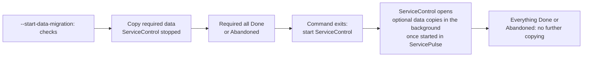
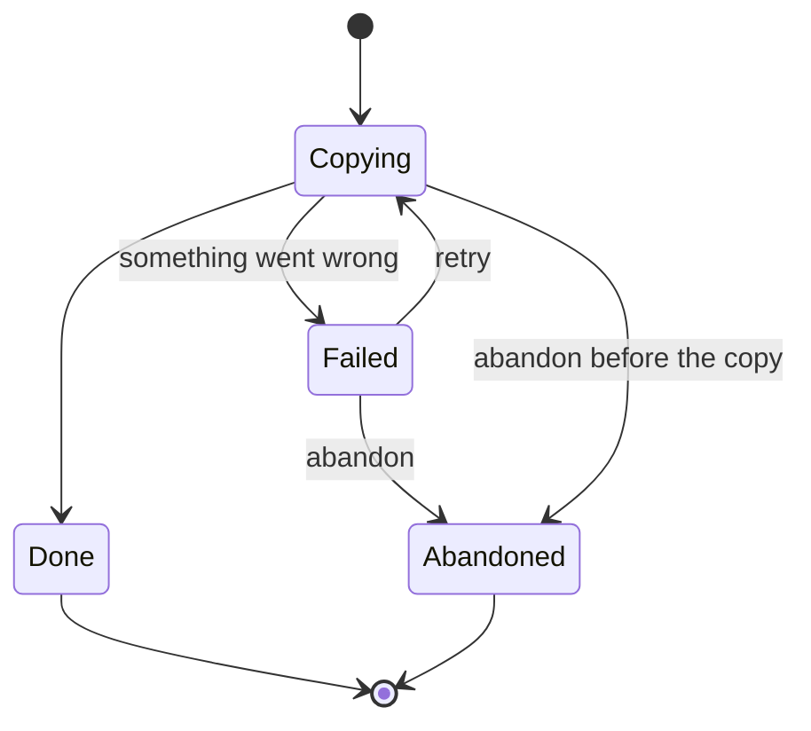
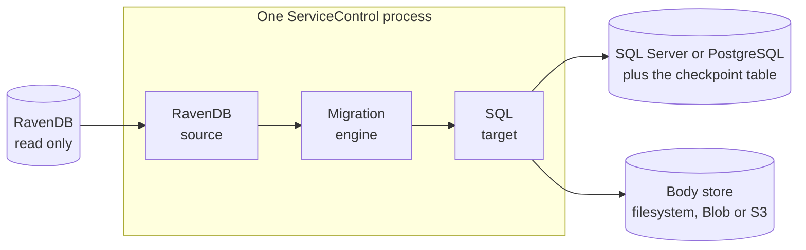
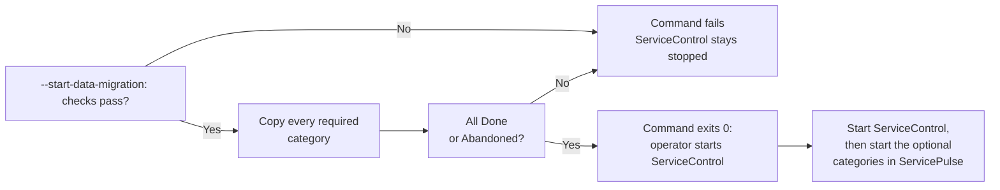
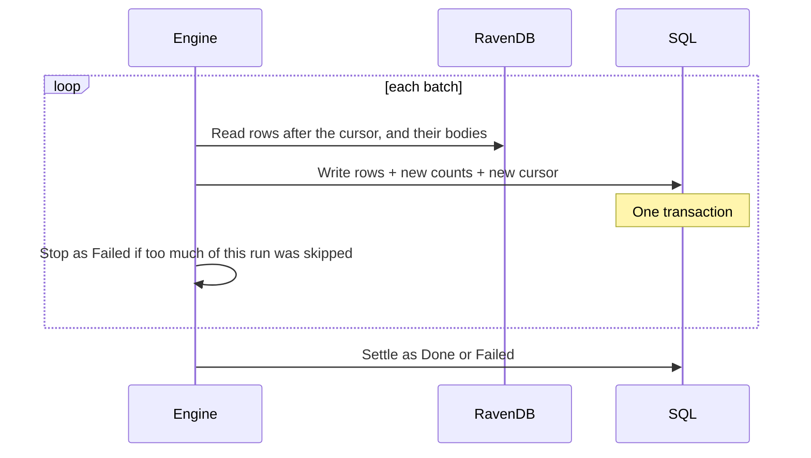

# Migration Engine: Design Overview

> [!NOTE]
> This build does not carry the whole migration yet. This page describes it as it will be when it ships.

[The instructions](ravendb-to-sql-migration-instructions.md) describe how an operator runs the migration, and the [system design](ravendb-to-sql-migration-system-design.md) provides the system architecture. See the [glossary](#glossary) for terms used throughout.

## Overview

### What this is

- The migration moves an **error instance's** data from RavenDB to SQL Server or PostgreSQL, so a customer can switch persisters and keep their data.
- The ServiceControl executable provides an interactive offline command and an online background copier. There is no separate tool.
- **The audit instance is out of scope.** There is no migration path for the audit instance.
- **The monitoring instance is out of scope.** It keeps its data in memory, so there is nothing to move.

### TL;DR

- **Retention does most of the work.** Error retention is 5 to 45 days and event retention defaults to 14 days, so most of RavenDB ages out on its own within weeks.
- **What the instance needs to open is copied while it is closed.** This is the *required* data. Most of it is small.
- **Everything else is copied in the background while it runs, once you start it in ServicePulse.** This is the *optional* data: the event log and archived and resolved messages.
- **Anything not copied ages out of RavenDB**, and the customer deletes the old database when ready.
- **The main thing that makes the outage long is a big backlog of unresolved failures.** They are required, rarely age out (see the [6.18 exception](#rows-removed-after-the-copy)), and can be months old. Keep them low by resolving and archiving. `--start-data-migration` counts them before it copies, and warns above 50,000.
- **A big archive does not make the outage longer, as long as RavenDB has indexed every failed message.** The copy finds unresolved failures through a RavenDB index, and waits for it to catch up first. If the index is broken or incomplete, the copy reads every failed message instead and logs a warning. Then a big archive does make the outage longer.

### When something goes wrong, you decide what happens next

The end goal is simple: **either all the data comes across, or you explicitly give up on a named part of it.**

- **Each *category* of data is in one of four states:** Copying, Done, Failed or Abandoned.
- **A category goes Failed when something went wrong**, for example a row it could not copy. It stays Failed. `--migration-status` shows its skip count and any error that stopped it, and the copy lists the rows it skipped as faults, by id and reason, when it ends.
- **For a required category, `--start-data-migration` asks you what to do**, with ServiceControl stopped:
  - Retry, after fixing the cause: the run copies the category again.
  - Abandon: give up on what it has not copied, and keep what it has.
  - Stop: the next run asks again.
- **An optional category is started, paused, resumed, retried or abandoned in ServicePulse**, with ServiceControl running. A paused category stays Copying, and `--migration-status` and ServicePulse show it as paused.
- **A restart never decides anything for you.** A Failed category stays Failed until you retry or abandon it, so a restart policy cannot loop or lose data.
- **ServiceControl opens once every required category is Done or Abandoned**, and the migration is finished once every category is.

### Goals

- **Short outage.** Only the required data copies while ServiceControl is closed.
- **Support every RavenDB hosting shape.** Embedded, self-hosted or RavenDB Cloud, on one code path.
- **Never write to RavenDB.** RavenDB's own expiration still deletes old failed messages and event log items.
- **No duplicates and no gaps.** The copied rows and the *checkpoint* commit together, so a crash needs no clean-up.
- **Every identifier anything points at is kept.** Only the event log, historic retry operations and pending integration events get new ids, because nothing points at theirs.
- **Refuses rather than half-migrates.** Every check runs before the first row moves.
- **No silent loss.** Every skipped row is counted with a reason, and a migration cannot finish with a category unfinished unless someone deliberately *abandons* it.
- **Gentle on a live instance.** The copy is streamed, so memory does not grow with the database, and there is a pause between background batches.
- **Known before it starts, visible while it runs.** `--start-data-migration` counts what the outage has to copy before it asks to start, and progress shows up as it happens.

### Non-goals

- **Zero downtime.** There is a real, if short, outage.
- **Rollback once ServiceControl opens.** Nothing copies SQL rows back to RavenDB.
- **A general-purpose migration tool.** The source is always RavenDB and the target is always one of ServiceControl's SQL persisters, both at versions this build can read. The migration engine is designed so it can be expanded in the future.

### The moving parts

- **Both persisters load into one ServiceControl process**, each in its own `AssemblyLoadContext`, and both are live during the copy.
- **The engine knows neither database.** It works only through `IMigrationSource` and `IMigrationTarget`, in categories, *cursors* and counts, so it can be tested on its own and expanded in the future.
  - The source maps each category to what it reads, and lists the settings it reads with where each came from.
  - The target maps each category to where it writes and how to count it.
  - Each side adds its own startup checks.
  - The engine passes the cursor from one side to the other without looking inside it.
  - RavenDB to SQL is the only supported pair, but the engine does not depend on it.
- **The source reuses the instance's existing RavenDB settings**, so an existing customer configures nothing new for it. Leave them in place when switching `ServiceControl/PersistenceType`.

### A migration from start to finish

[The instructions](ravendb-to-sql-migration-instructions.md) define the migration steps.

- **The [free abort](#going-back-to-ravendb) window runs from the first `--start-data-migration` invocation until ServiceControl opens.** A successful command does not end this window; starting ServiceControl does.
- **While required data is still copying, none of ServiceControl's own clean-up runs**: the retention sweep, the purge API, the heartbeat settings sync and throughput collection. The offline command never starts the host, and normal startup refuses while a required category is unfinished.

## Design

### Supported locations

The copy goes from RavenDB, through the ServiceControl host, to SQL, because documents must be reshaped into tables and ServiceControl's persisters already know both sides. So the host must reach both ends, and distance matters.

| | Supported locations |
| --- | --- |
| RavenDB source | Embedded on the host (Windows installations only), self-hosted on the network (container, VM or bare metal), or RavenDB Cloud |
| SQL target | SQL Server or PostgreSQL on the host, on the network, in a container, or managed (Azure SQL, Amazon RDS, Google Cloud SQL) |
| Body store | Wherever the target is configured to put bodies: filesystem, Azure Blob or S3. Small text bodies stay in the database. This choice is made at the same time as the database move |

| Route | What to expect |
| --- | --- |
| On-prem to on-prem | The common case, and the fastest: embedded or self-hosted RavenDB to SQL on the same host or network |
| On-prem to cloud | Works. Each batch is a round trip, so write latency adds up per batch |
| Cloud to on-prem | Works. The customer pays egress on everything copied, mostly archived messages and their bodies |
| Cloud to cloud | Works, but only sensible when ServiceControl runs next to one of them. A host on-prem between two clouds pulls every byte down and pushes it straight back up |

**Requirements:**

- The host reaches the RavenDB source, the SQL target and the body store at the same time.
- The SQL database is new and empty: only the schema `--setup` created.
- Both RavenDB databases, primary and throughput, are on one server or cluster. The migration opens both through one `IDocumentStore`, and so does the licensing component.
- A SQL Server target has Full-Text Search installed, because message search needs it. `--setup` fails without it, and the stock SQL Server container image does not include it. PostgreSQL needs nothing extra.
- Transient failures on a managed target are retried by default.

**Not supported:**

- Any server-to-server copy: backup and restore, RavenDB ETL or replication, or an external pipeline.
- A host that can reach only one database at a time, so no staged move through an offline copy.
- An embedded RavenDB source when ServiceControl runs in a container. Reading an embedded database means starting a RavenDB server process, and the container image does not include one.
- Primary and throughput RavenDB databases in different places.
- Any source other than RavenDB, or any target other than a ServiceControl SQL persister.

### What data moves

There are eighteen *categories*: sixteen required and two optional.

| Category | Kind | Why |
| --- | --- | --- |
| Unresolved and retry-issued failed messages, with bodies | Required | The point of the instance. Issuing a retry removes the expiry, so retry-issued messages never age out. Leave one behind and the retry confirmation finds no row to resolve, so the message stays missing even though the retry succeeded |
| Message redirects | Required | |
| Known endpoints, with the monitored flag | Required | The flag is part of the endpoint row |
| Endpoint settings | Required | Copied after known endpoints |
| Notification settings | Required | |
| Licence trial end date | Required | |
| Licensing endpoint records | Required | The per-endpoint rows in the throughput database |
| Throughput history | Required | Copied after licensing endpoint records, because each day's row hangs off one |
| Retry operations, unacknowledged and historic | Required | One category, because RavenDB holds both lists in one document |
| Licensing report masks | Required | |
| Uploaded licensed endpoint details file | Required | Nothing recomputes it. Losing it means downloading it again from the licence portal and uploading it again |
| Subscriptions | Required | |
| Integration events still waiting to be sent | Required | Each is an event a subscriber has not received yet. There are only any if the old instance fell behind or could not reach the broker. They are sent once ServiceControl opens, later than they would have been, except a `MessageFailed` event for a message archived or resolved before the move (see [Rows removed after the copy](#rows-removed-after-the-copy)). RavenDB sends them in no particular order anyway, so no ordering is lost |
| Custom checks, with their last status | Required | Not every check reports again. An endpoint that is down never does, and a check with no repeat interval reports only when its endpoint starts. Leaving one out could hide a known failure until that endpoint restarts. Results of the six checks the RavenDB persister runs about its own database, matched on id and category, are left out, as harmless skips |
| Failed error imports, with bodies | Required | Messages taken off the error queue but not ingested. They exist nowhere else and never expire. After the move the "Error Message Ingestion" custom check keeps flagging them and `--import-failed-errors` imports them into SQL. Importing them on RavenDB first is better still |
| Group comments | Required | Copied after unresolved failed messages, so a note like "do not retry" is there when ServiceControl opens. Blank comments are not copied. Some comments are removed after ServiceControl opens, see [Open decisions](#rows-removed-after-the-copy) |
| Event log | Optional | The history behind the ServicePulse activity feed. On a busy instance it holds a row for every failure, retry and submission |
| Archived and resolved failed messages, with bodies | Optional | The biggest category by far, and most of the copying time |

**Never copied, because nothing needs them:**

- RavenDB index definitions.
- In-flight work collections, which are empty when nothing is running: `RetryBatches`, `RetryBatchNowForwardings`, `ArchiveOperations` and `UnarchiveOperations`.
- `ArchiveBatches` and `UnarchiveBatches`, which exist only because of how RavenDB works.
- The `ConnectedApplications` document, written only by versions 6.0 and 6.1. Nothing has read it since 6.2.
- Broker and audit service version details, which refill on the next throughput collection.
- Failed message edit locks, which stop one failed message being edited twice. See [Open decisions](#values-that-change-or-merge-in-sql).
- Heartbeat state, which neither persister stores. It is rebuilt in memory, so monitoring after the move behaves as after any restart.

**Written new by the copy rather than copied:**

- Retry claims in `FailedMessageRetries`. A claim ties a message to the retry that sent it. The copy writes one for each retry-issued message it inserts that RavenDB still held a claim for, so a retry by id sends or holds back a message just as it did before the move.

### Optional data windows

- **Each optional category copies only rows inside its *window*:** events raised within it, or messages archived or resolved within it.
- **The window is chosen in ServicePulse when the category is started.** `--start-data-migration` sets nothing for the optional categories.
- **The default window is the instance's own retention period**: `ServiceControl/EventRetentionPeriod` for the event log, `ServiceControl/ErrorRetentionPeriod` for archived and resolved messages. So by default everything RavenDB still holds is copied.
- **To skip a category, abandon it in ServicePulse.** A longer window than the retention period copies nothing extra, because older rows would only be deleted by SQL's clean-up.
- **The window counts back from when the category first started copying**, which the checkpoint records, so a restart copies the same window rather than one that has slid forward.

### Data that changes shape

- **Event log items, historic retry operations and pending integration events get new numbers.** Nothing refers to the old ones, so this is safe. For historic retry operations and pending integration events, the log says so once per category, in an information line.
- **Other values change or merge on the way into SQL.** Each is listed under [Open decisions](#values-that-change-or-merge-in-sql), with the line the log shows for it.
  - A row copied with a changed value logs a warning starting `Changed <source id> in category <category> on the way into SQL:`, followed by what changed and what was kept.
  - A row merged into another logs a warning starting `Merged <source id> in category <category> into a row with the same key:`, naming both keys, the source row kept, or the row SQL already held, and the source row dropped.
  - The category's summary at the end of the copy counts both, apart from the rows already present, for example `Subscriptions: 14 copied (0 changed), 0 already present, 1 merged, nothing skipped`. The summary is a warning when anything was changed or merged. The counts cover only the current run: a category resumed after a crash counts only the changes and merges of the run that finished it, and counts earlier merges as already present.
  - The summary's already present count leaves out the merged rows. If the copy reports more merged rows than SQL found already present in total, the summary adds a warning naming both counts, because the copy's prediction of which keys SQL treats as equal then disagrees with SQL.
  - The per-row lines are written after each batch commits. If the process stops between a batch's commit and its log lines, those lines are lost. A resumed copy does not repeat them, because it finds those rows already present.

### Skipped rows

Every skipped row is counted under a reason. When each copy pass of `--start-data-migration` ends, the console lists the rows that pass skipped: each fault skip with its category, id and reason, and the harmless skips as a count per category and reason.

> [!IMPORTANT]
> Outside a container, the log file of the run, `migration-<yyyy-MM-dd-HHmmss>.txt`, has a warning for every skipped row, harmless skips included, with its category, id, reason and detail. A log level above Warning drops these lines. In a container the log goes to the console, so there the console output is the only record. Keep the log file or the console output, and look the rows up in RavenDB while you still have it.

A skip is one of three kinds:

- **Fault, a retry can fix it.** Something outside the data went wrong. Fix the cause and retry.
- **Fault, no retry can fix it.** The RavenDB document cannot become a SQL row, so a retry skips it again. Only [abandoning](#retry-and-abandon) gets past it.
- **Harmless.** A row SQL would have removed anyway, or a result of a check the source's own storage runs about itself (the RavenDB source flags its own checks, and the target skips flagged rows).

A value SQL can hold only after changing it is not a skip. Those rows are copied, and are listed under [Open decisions](#values-that-change-or-merge-in-sql).

Verify and the startup refusal name each skip by the reason in the first column.

**"Fault skips" a retry can fix:**

| Reason | What it means | Categories |
| --- | --- | --- |
| `BodyUnreadable` | A message body that cannot be read after three tries. The whole message is skipped, because a message with no body is worse than none | Failed messages |

An error from the SQL target skips no row. It stops a required category, which is then Failed. An optional category stays copying with the error on its row, and the next start resumes it.

**"Fault skips" no retry can fix:**

| Reason | What it means | Categories |
| --- | --- | --- |
| `BodyMissing` | A message body that RavenDB does not hold. The whole message is skipped. A retry does get past a message that expired during the copy | Failed messages |
| `UnparseableUniqueMessageId` | A `UniqueMessageId` that is not a GUID. It is the key, the ServicePulse URL and the retry key, so it is never regenerated | Failed messages |
| `NoProcessingAttempts` | A failed message with no processing attempts, so nothing to fill its required failure time, failing endpoint and exception from | Failed messages |
| `RequiredValueMissing` | A row missing a value SQL requires, such as a known endpoint with no name, or a failed message with no failing endpoint address to retry to | Every category except endpoint settings, group comments and the four settings categories |
| `ValueTooLong` | A text value too long for its SQL column, such as a failed message id or failing endpoint address over 450 characters, or a subscription's message type or address. Cutting it would change a key or send retries to the wrong address. The skip names the column and the length | Any category |
| `MalformedValue` | A value of the wrong type, such as a `TimeSent` that is not a date. On PostgreSQL, also a text value holding the character U+0000, which PostgreSQL cannot store | Failed messages for a wrong type; any category for U+0000 |

**Harmless skips:**

| Reason | What it means | Categories |
| --- | --- | --- |
| `BlankGroupComment` | A blank group comment, which SQL never stores | Group comments |
| `PastRetention` | An archived or resolved message, or event log item, already past its retention period | Archived and resolved failed messages, event log |
| `SourceStorageCheck` | A result of one of the six checks the RavenDB persister runs about its own database, such as index lag or free disk space, matched on the check's id and category. Only a RavenDB primary instance reports these checks, so nothing updates them after the move. A check that reuses one of these ids under another category is copied, such as a RavenDB audit instance's dirty memory check | Custom checks |

`Unknown` is not a reason of its own. It stands for a reason that a newer ServiceControl recorded and this build cannot name. It counts as a fault a retry can fix, because the rows behind it may be a real loss. Run `--start-data-migration` from the newer build to see the reason named in its verify step.

- **Any fault skip makes the category [Failed](#failed-categories)**, even one. Harmless skips leave it Done.
- **A malformed document does not stop the copy.** It is skipped and counted, and the rest of the category carries on. If skips pass the [early-stop threshold](#failed-categories), the category stops where it is, and abandoning it then gives up every unread row too. Raise the threshold or fix the cause, and retry.
- **Endpoint settings for an endpoint ServiceControl does not know are copied, not skipped.** ServiceControl removes them itself shortly after it opens.
- **Rows outside a window are not skips.** They are simply not part of the copy.
- **Rows RavenDB expires during the copy are not skips either.** Only archived or resolved failed messages and event log items expire, plus some unresolved messages from 6.18 or earlier (see [Open decisions](#rows-removed-after-the-copy)).
  - A message that expires between the copy reading it and reading its body is a `BodyMissing` fault skip. A retry gets past it.
  - If the message a stopped copy was at expires before the next start, the category stops with an error naming the missing id. A retry gets past it.
  - A window shorter than the retention period keeps the background copy clear of the expiry sweep.

### Startup checks

In this order, cheapest first. `--start-data-migration` prints one line for each: `[ok]`, `[FAIL]` or `[skip]`, then the check's name, and for some checks what it checked against, in brackets.

1. Source and target are the supported pair, RavenDB to SQL. Answered from settings alone. `--start-data-migration` refuses a RavenDB target, because RavenDB is only ever the source.
2. `ServiceControl/RetryHistoryDepth` is above zero. At zero or less, the first completed retry after the migration deletes the whole copied retry history.
3. The SQL schema is current. This also refuses a database upgraded without `--setup`.
4. Until a required category has started copying: the SQL database holds no ServiceControl data. `--setup` writes none, but even one plain start of ServiceControl writes rows. Copying into a database that already served on SQL would mix the two.
5. Message body storage is writable. The probe body it writes is deleted again.
6. The SQL target opens.
7. The RavenDB source opens:
   - an embedded server starts;
   - on an external server, the client certificate is in date and an `https://` address has one, checked before the first request;
   - an external server is at least the RavenDB client's version;
   - both databases load, within 5 minutes each on an embedded source.

   If every required category is already Done or Abandoned, the offline command goes on without the source: this check shows `[skip]` with the error, verify is skipped, and the command exits with 2. Normal startup does not need the source; only the online copier opens it.

The first `[FAIL]` stops the run and says why. The checks after it show `[skip]`.

- **The host also stays closed** if a second instance is writing the same checkpoints.
- **When ServiceControl opens**, the target is marked as opened, which ends the [free abort](#going-back-to-ravendb).
- **Once it has opened, a RavenDB outage does not stop it.** Only the background copy needs the source then, so ServiceControl opens anyway, and the optional categories [wait for the source](#failed-categories) to come back.

### Reading from RavenDB

- **The source opens RavenDB read-only**: connect, check the version, stop. It never runs RavenDB's database setup, and it refuses any write request.
- **Both source databases are opened through one `IDocumentStore`**, which is why they must be on the same server or cluster.
- **Upgrade on RavenDB first**, so the build doing the copy is the one that last ran against the source. Nothing checks this.
- **Distance to the source sets the pace.** Each message body is one round trip, and they are not batched. Egress out of RavenDB Cloud is billed to the customer.

### Writing to SQL

- **A failed message is written as one row**, with its status unchanged. Its older attempts are dropped, see [Open decisions](#values-that-change-or-merge-in-sql).
- **A failed message keeps its failure groups and its last-modified time**, so filtered lists show the same messages as before. A failure group with no id is the exception, see [Open decisions](#values-that-change-or-merge-in-sql).
- **`UniqueMessageId` keeps its value** but becomes a `uniqueidentifier`. It is the primary key, the ServicePulse URL, the retry key and the body key.
- **`StatusChangedAt` is rebuilt.** For archived and resolved messages it is `@expires` minus the current `ServiceControl/ErrorRetentionPeriod` (wrong if that changed, see [Open decisions](#values-that-change-or-merge-in-sql)). For unresolved and retry-issued messages it is the newest attempt's time, because the column is `NOT NULL`.
- **Bodies go through `IBodyStoragePersistence`**, which handles compression and the body store. The copier keeps a body inline when it is within `ServiceControl/MaxBodySizeToStore` (102,400 bytes by default), as ingestion does.
- **Throughput rows are written directly, and each day's count is added to the stored count**, as ServiceControl's own throughput write adds it. Endpoints whose names the SQL key treats as one have their counts for a day summed into one row: SQL Server compares names under the key column's own collation, and PostgreSQL compares them as its deterministic collations do, character for character. A resumed copy cannot double-count, because each batch and its checkpoint commit together. The copied rows also stop the collectors gathering the same days again.

### Batch size and throttling

- **Batch size comes from the database.** SQL Server divides its parameter budget by the column count, PostgreSQL uses a flat 50 rows.
- **Background batches have a pause between them**, 100 ms by default, set by `ServiceControl/Migration/ThrottlePauseMilliseconds`. The first batch of each category is not paused.
- **Raise the pause if the copy competes with production.** There is no enable switch. To stop an optional category for a while, pause it in ServicePulse. To stop it for good, abandon it there.
- **The required copy is never paused**, because ServiceControl is closed and nothing competes with it.

### Progress and checkpoints

The checkpoint is one row per category in the SQL database, created by `--setup`. It holds the category's *state*, cursor, counts, timings and last error, plus a version number that catches a second writer. `--start-data-migration` also saves the RavenDB row count of a required category, which gives the progress percentage.

- **Progress never gets ahead of the data.** Rows and cursor commit together, so a restart never skips rows that were not written.
- **A crash costs only the batch in flight.** Rerun `--start-data-migration` for required data, or restart ServiceControl for optional data. The copier resumes from the committed cursor.
- **A batch read twice is counted once.** Rows already in SQL come back as *already present*, never as copies or skips, so every category is safe to run twice.
- **Every skip has a reason, or the save is refused.**
- **A second writer is caught, not merged.** Each save carries the version it read, so two hosts pointed at one database cannot interleave.
- **A copy stopped between two categories still shows the ones it never reached.** Each start first saves a *not started* row for every category it will copy.
- **Only the copier and `--start-data-migration` write the checkpoint.** `--migration-status` only reads it.

### Failed categories

A category is *Failed* when something went wrong. What it copied stays committed, and it stays Failed, with the reason, until you [retry or abandon](#retry-and-abandon) it.

**What makes a category Failed:**

- **Any fault skip by the end of the category**, even one.
- **Too many fault skips in this run, which stops it early:** more than 5% of the rows processed so far *and* more than 100 rows (`ServiceControl/Migration/HaltThresholdPercent`, `ServiceControl/Migration/HaltThresholdMinimum`). Below that, a category runs to the end, so you see every bad row in one pass.
- **The category's own counts not balancing:** every row read must be copied, skipped or already present.
- **In a required category only, an exception or a stall of 30 minutes with nothing committed**, such as the body store unreachable, a certificate expired, the source or target down, or the disk full. The error and the cursor are recorded.

**What does not make it Failed:**

- **Harmless skips.**
- **A shutdown or a crash.** The category stays Copying. The next `--start-data-migration` invocation resumes required data; the next ServiceControl start resumes optional data.
- **An exception or a stall in an optional category**, including a RavenDB outage. The error shows in status, and the next start carries on from the cursor.

**What a Failed category costs:**

- **The other categories still run**, so one fix-and-retry covers them all. A category that depends on a Failed one waits.
- **A Failed required category** keeps ServiceControl closed until it is retried to Done or abandoned. That is deliberate: opening the host is the point of no return.
- **A Failed optional category** leaves the instance running with that slice missing, and stops the migration being finished.

Some losses leave a category Done without any check noticing. They are listed under [Open decisions](#what-the-checks-do-not-catch).

### Retry and abandon

`--start-data-migration` offers retry and abandon for each Failed required category, in its *Failed categories* step. Without a console it takes the answer from an argument instead.

| Choice | Argument | Works on | What it does |
| --- | --- | --- | --- |
| `r`, retry now | `--retry=<category>` | A Failed required category | Resets it, then copies it again in the same run. An argument is used once per run |
| `a`, abandon | `--abandon=<category>` | A Failed required category, or `UnresolvedAndRetryIssuedFailedMessages` above 50,000 rows before the copy | Gives up on what it has not copied, and on any category whose rows hang off it. What they copied stays in SQL. Final |
| `s`, stop | none | | Ends the run with exit code 1. The next run comes back to this step |

An optional category is retried or abandoned in ServicePulse, not by a command. A Failed optional category stays Failed until then, and `--migration-status` shows it.

**To retry:**

1. Read the reason. The run shows why the category failed, with the skip reasons, and the copy lists each fault skip by id when it ends. `--migration-status` shows the skip count and any error, but not the skip reasons.
2. Fix the cause. It is usually outside the migration: the body store unreachable, a certificate expired, the source or target down, or the disk full.
3. Answer `r`, or stop and run `--start-data-migration` again once the cause is fixed.

An optional category that an error left copying resumes by itself on the next start.

**What a retry does:**

- **It re-reads the whole category from the start**, leaving rows already in SQL alone. Every body is read again, so a retry takes about as long as the first copy.
- **Historic retry operations, pending integration events and throughput history** are deleted first. The first two get new keys on every insert, and throughput history adds each day's count to the stored one, so a re-read would copy them a second time. The retry deletes what the category copied, in the same save as the reset. This is safe because all three are required, so the target started empty and ServiceControl has not opened on it. Once ServiceControl has opened on the database, a retry of any of them is refused and deletes nothing.
- **The event log cannot be retried.** It also gets new keys, but it copies after ServiceControl opens, when copied rows cannot be told apart from live ones. It can only be abandoned.

**To abandon:**

- **The run offers abandon for a Failed required category**, and before the copy for `UnresolvedAndRetryIssuedFailedMessages` above 50,000 rows. The run shows what is lost, and you type `ABANDON` to confirm. An `--abandon` argument does not ask.
- **Abandon a required category only after a copy has failed and a retry did not help**, or when the warning shows more unresolved failed messages than are worth the outage. Until ServiceControl first opens on SQL, going back to RavenDB loses nothing.
- **An abandon before the copy is saved when the copy starts**, so a stop before that writes nothing.
- **Abandoning cascades** to throughput history (from licensing endpoint records) and endpoint settings (from known endpoints), and the run names each before you confirm. Group comments are not abandoned with unresolved failed messages.
- **A category that failed only on [skips no retry can fix](#skipped-rows) should be abandoned, not retried.** If it stopped early at the threshold, raise the threshold and retry first, because abandoning gives up every unread row too.

> [!IMPORTANT]
> Abandon is final. Nothing goes back for an abandoned category, so it is right when the data is not worth the outage, and wrong if picked by accident.

### Ingestion workers

- **An `--error-ingestion-only` worker never runs the copy.** On RavenDB it is refused, because only SQL can scale out.
- **On SQL it starts only when every required category is Done or Abandoned**, based on SQL checkpoints. Otherwise it refuses and names each required category still outstanding. Optional categories still copying do not hold it back.
- **Every SQL writer runs that check**, because ingesting into a part-copied database would make going back a loss.
- **`--import-failed-errors` on SQL runs the same check**, because it writes failed messages too.
- **A worker or import that passes the check marks the target as opened**, which ends the free abort, because going back would lose what it wrote.

> [!IMPORTANT]
> **Stop workers before running `--start-data-migration`, and restart them only after the main host has opened.** A worker cannot detect a migration before its first checkpoint exists, see [Open decisions](#gaps-nothing-enforces).

### Going back to RavenDB

**While ServiceControl is closed**, RavenDB is still the source of truth, because the migration writes nothing to it. This is the *free abort*. RavenDB's own expiration still runs unless you disabled it.

- **To go back:** point `ServiceControl/PersistenceType` back at RavenDB, and start. You lose the copy, not your data.
- **To try again later:** start from a new, empty SQL database (`--setup`).

> [!IMPORTANT]
> Never reuse the old copy. It would skip every category already finished and miss anything RavenDB received since. Nothing detects the reuse, see [Open decisions](#gaps-nothing-enforces).
>
> **Once ServiceControl opens**, new failed messages go to SQL and there is no way back. You can only finish the migration.

- **Every SQL start checks the checkpoint table.** An unfinished required category keeps the host closed until `--start-data-migration` finishes it. An optional category started in ServicePulse and not finished runs on the online copier, and does not stop ServiceControl opening. With nothing outstanding, ServiceControl does not open RavenDB.

**Keep RavenDB until every category is Done or Abandoned.** Before ServiceControl opens, nothing can start without it. After that, the optional categories wait for it. If RavenDB is lost before the migration is finished, it must be restored to finish the migration.

### The offline command

`--start-data-migration` is the one command for the offline part. It runs with ServiceControl and every ingestion worker stopped, never starts the host, and asks before it does anything that cannot be undone. It first asks you to confirm that everything is stopped. Then it numbers only the steps that apply to the state it finds, so running it again continues from where the migration is:

| Step | What it does | When it runs |
| --- | --- | --- |
| Configuration | Prints every value the migration will use and where it came from, with passwords masked, then asks "Is this correct?" | Every run |
| Checks | Runs the [startup checks](#startup-checks), one line each | Every run |
| Rows to copy | Counts each required category that is not finished, and on a first run warns above 50,000 unresolved failed messages | Until every required category is Done or Abandoned |
| Start the copy | Asks "Start the copy?". Nothing is copied before the answer | Before the copy has started |
| Copying required data | Copies each required category with progress, then lists the rows it skipped | Until every required category is Done or Abandoned |
| Failed categories | Offers [retry, abandon or stop](#retry-and-abandon) for each Failed required category | When one is Failed |
| Verify | Compares RavenDB with the rows the copy read | Every run that gets this far |

- **No migration data is written before "Start the copy?"**, so a run that stops there leaves the SQL database as it was. The probe body of the body storage check is the one write, and it is deleted again. This is how to see the counts and the warning before booking the outage.
- **How the rows step counts.** It reads every required category in full, except the unresolved failed messages, which it counts through a RavenDB index, so that count is quick however large the backlog is. When the index is broken or incomplete, it reads every failed message instead. Counting failed error imports reads their bodies, because RavenDB keeps each one inside its document.
- **The large-backlog warning** shows on a first run when there are more than 50,000 unresolved failed messages, a limit fixed in code. It advises setting `PersistenceType` back to RavenDB and archiving or resolving them in ServicePulse first, because archived and resolved messages are not copied during the outage. It offers to stop, to continue, or to abandon the category. Without a console, the run stops there unless `--abandon=UnresolvedAndRetryIssuedFailedMessages` is given, and no argument continues past it. A resumed run keeps the answer the first run gave, but still acts on that argument until the category starts copying.
- **Progress** shows as one line per required category: rows done, the total from the rows step, and a percentage. In a console window the line is redrawn in place. When the output is redirected, or in a container, a new line prints at every 10%.
- **Every question has an argument**, so the command runs without a console: `--non-interactive`, `--abandon=<category>` and `--retry=<category>`. With no console and no `--non-interactive`, the run fails at the first question and names the argument. It never waits.
- **Exit codes:** 0 when verify is clean. 1 when you answered no or stopped, a check failed, a category is Failed, verify found a category `INCOMPLETE`, a run without a console stopped at the warning, or the run was cancelled. 2 when nothing is outstanding but verify found `ROWS NOT READ`, or verify could not run because RavenDB would not open.
- **The command logs to its own file** for each run, named `migration-<yyyy-MM-dd-HHmmss>.txt`, in the log folder of the instance. A run started in the same second as the one before adds to its file. The console carries only the steps, and the run names its log file when it ends. An argument the command refuses prints the reason and names no log file. In a container the log goes to the console.

**When each command can run:**

| Command | What it does | Opens RavenDB? |
| --- | --- | --- |
| `--start-data-migration` | The steps above | Yes. With every required category Done or Abandoned, it goes on when RavenDB does not open, and skips verify |
| `--migration-status` | Each category's state, progress as a share of the rows `--start-data-migration` counted, last error, and for a Failed required category the arguments that retry or abandon it | No, so it runs any time |

- **On an embedded source, stop the ServiceControl service before `--start-data-migration`.** A second RavenDB process cannot use a data directory the first one holds.
- **Verify in a run that finds the required copy already settled reads every required category in full**, though not the bodies, so it takes a while on a big instance.
- **In a container**, run each as a one-off `docker run` of the same image against an external RavenDB server.

**What verify compares:**

- **RavenDB against the rows the copy read, never against SQL now**, because normal use changes SQL rows within minutes of opening.
- **Verify judges only the required categories.** In the run that copied, it uses the counts from the rows step. ServiceControl is stopped, so RavenDB has not changed since the count. A run that finds the required copy already settled counts RavenDB again. ServicePulse shows the optional categories.
- **RavenDB holding more rows than the copy read means rows were never read.** Keep RavenDB. The same flag shows if something else wrote to RavenDB, such as an old instance still running on it.
- **RavenDB holding fewer is shown, not judged**, because expiry keeps deleting rows after the copy reads them. Expiry can also hide rows that were never read, see [Open decisions](#what-the-checks-do-not-catch).
- **Verify lists skipped rows by reason, and the rows each abandoned category never read.** Neither changes the exit code. Only rows not read make it exit 2 once nothing is outstanding, so a script stops for a person to read the report.

### Monitoring and settings

| Setting | Default | What it does |
| --- | --- | --- |
| `ServiceControl/Migration/ThrottlePauseMilliseconds` | `100` | Pause between background batches |
| `ServiceControl/Migration/HaltThresholdPercent` | `5` | Percentage part of the early-stop threshold |
| `ServiceControl/Migration/HaltThresholdMinimum` | `100` | Floor part of the early-stop threshold |

- **The source needs no new settings.** It reads the instance's existing RavenDB settings.
- **Settings are read fresh at every start.**
- **Progress of the required copy shows on the console of `--start-data-migration` and in `--migration-status`.** Outside a container, that command logs to its own file for each run, not to `logfile.txt`.
- **Progress of the background copy shows in the ServiceControl log and `--migration-status`.** The ServicePulse activity feed shows when a category fails and when RavenDB cannot be reached. There is no migration custom check. ServicePulse shows migration status in a view of its own instead.
- **ServicePulse controls the background copy through the ServiceControl API.** It starts, pauses, resumes, retries and abandons an optional category. The required copy has no API, because ServiceControl is closed while it runs, and nothing aborts the whole migration.

## Open decisions

Each case below changes, merges or drops data, or lets a loss pass without failing a category. The design accepts each one for now, but each needs a decision before the migration ships.

### Values that change or merge in SQL

- **Attempt history collapses to the newest attempt.** SQL keeps the newest attempt and the attempt count, so only the newest attempt keeps its headers and exception. This is not logged and not counted as a change, because SQL keeps only the newest attempt for every message that failed more than once, by design.
- **A failure group with no id is dropped from its message, and a group with no title or type is stored with an empty one.** SQL keys a group by its id, so the message is missing from that group in ServicePulse, and a group retry or archive leaves it out. ServiceControl's classifiers always set an id, so this needs hand-made data. The log names each message, in a warning whose detail starts `Dropped the failure groups with no id` or `Stored an empty title or type for the failure groups that had none`.
- **Two failure groups of one message whose ids SQL treats as one key become one**, keeping the first group's title and type. ServiceControl never gives a message the same group twice. The log names each message, in a warning whose detail starts `Kept the failure group '<id>' titled '<title>' and dropped`.
- **Message redirects, subscriptions, pending retry operations, group comments and failed error imports merge when their keys match in SQL.** The copy keeps one row, counts the other as already present, and logs a warning starting `Merged <source id> in category <category> into a row with the same key:` naming both. On SQL Server the copy predicts these merges from the key column's collation settings for case, accents, kana type and width, plus SQL Server's trailing-space rule, and reports the merges those settings make. It compares text with .NET's culture rules rather than SQL Server's own tables, so an unusual character the two treat differently can merge without a line.
  - Redirects merge on source addresses the key column treats as equal. On SQL Server, by default, that includes addresses that differ only in case.
  - Subscriptions also merge when they differ only in message-type version, because the SQL key leaves the version out. The warning names the version and endpoint of the row kept and of the row dropped.
  - Pending retry operations with the same retry type and request id merge, keeping the latest. The warning names the source row kept and the one dropped, and each source id ends with that operation's completion time.
  - On SQL Server, group comments merge when their group ids differ only in trailing spaces. ServiceControl makes every group id from a GUID, so only a comment written on a hand-made group id can merge. PostgreSQL keeps both.
  - Failed error imports of the same message merge. Version 6.18 and earlier stored each failed import attempt as its own document, and SQL keeps one row per message. The copy keeps the first it reads, and for those documents RavenDB order is effectively random, so it can keep an older attempt's exception. The warning names both documents, or the stored row's failure time and this one's.
- **On SQL Server, endpoint settings whose names differ only in case, kana type or width merge into one row**, because the name column's default collation ignores all three. A column whose collation also ignores accents merges those too. PostgreSQL keeps both.
  - The copy keeps the setting whose name exactly matches a known endpoint, because ServiceControl deletes the other. Otherwise it keeps the first in RavenDB order, which is effectively arbitrary.
  - The choice is made within one batch of up to a thousand. Across batches, the first one met wins.
  - The copy logs a warning starting `Merged EndpointSettings/<name>` that names both names and the one kept.
- **A message type over 450 characters is cut to its last 450 characters**, as ingestion does. The row is copied, not skipped. The log names each message, in a warning whose detail starts `Cut the message type from <length> characters to its last 450`.
- **On SQL Server, licensing endpoints whose names differ only in trailing spaces become one row**, and a day both counted holds the sum. PostgreSQL keeps both.
  - The copy keeps the endpoint it meets first, counts the other as already present and logs a warning starting `Merged <source id> in category LicensingEndpoints` naming both. Within one batch the endpoint met first is the one whose source id sorts first, and an endpoint SQL already holds is met before any in the batch.
  - A key column whose collation also ignores, for example, accents, kana type or width makes one row in the same way, a day holds the sum of every endpoint the column treats as one, and the copy logs the same warning for it.
- **`StatusChangedAt` is wrong for an archived or resolved message if `ServiceControl/ErrorRetentionPeriod` changed since RavenDB stamped it.** It is off by the difference, but the message still ages out of SQL when RavenDB would have deleted it. No log line flags these.
- **Failed message edit locks are not copied.** On RavenDB, an edited message that fails again can never be edited again. After the move it can be edited once more. No log line lists these messages.
- **A failed message's sending and receiving endpoints are rebuilt from its headers** when RavenDB hands back the stored endpoint without its type, following ingestion's own rules on the same headers. A message whose headers name no endpoint gets none. No log line names these messages.
- **A failed error import's failure time is when RavenDB last modified its document**, because RavenDB stores no failure time for an import. ServiceControl never changes an import after storing it, so this is when the import was stored. No log line names imports for this. A missing exception or body is stored empty, and the log names each such import, in a warning whose detail starts `Stored an empty exception`, `Stored an empty body` or `Stored an empty exception and an empty body`.

### Rows removed after the copy

- **A group comment on a group whose messages are all archived or resolved is removed soon after ServiceControl opens**, because that group has no failed messages in SQL until the background copy brings them. The same happens when the group's messages are gone from RavenDB or were skipped by the copy. The copy names each such comment, in a warning starting `Changed GroupComment/<group id> in category GroupComments on the way into SQL: The group '<group id>' has no copied failed message`, which also quotes the whole comment.
- **A `MessageFailed` event still waiting to be sent for a message archived or resolved before the move is never sent.** ServiceControl looks the message up when it sends the event. Archived and resolved messages arrive only with the background copy, so the lookup finds nothing, and the event is deleted with no log line. RavenDB would have sent it.
- **Unresolved messages from version 6.18 or earlier can expire during the copy.** On those versions, a message that failed again after being archived or resolved kept its expiry. One deleted before the copy reads it is not copied and not counted. No log line names these messages.

### What the checks do not catch

- **Nothing counts RavenDB during the copy.** A read that ends early still balances and ends Done. Verify finds it afterwards.
- **Rows never read on a Done category are reported, not fixed.** Verify exits 2 for them rather than 1, and no command can recopy a Done category. Keeping RavenDB is the remedy.
- **Verify uses the same reader as the copy**, so it cannot catch a reader that always misses the same rows, or a source pointed at the wrong database.
- **Expiry can hide rows that were never read**, because in verify a deleted row and a missed row cancel out.
- **A write that silently stores fewer rows still ends Done**, because already present is what is left after copied and skipped.
- **A crash during a batch with bodies leaves orphan bodies** in the body store, never rows pointing at missing bodies.

### Gaps nothing enforces

- **An ingestion worker started at the same moment as the first migration start can slip in before the first checkpoint exists**, and ingest into a part-copied database. Only the instructions prevent this.
- **Reusing an old copy after going back to RavenDB cannot be detected**, because it looks exactly like a normal resume. The copy skips every category already finished and misses anything RavenDB received since.

## Glossary

- **Category:** one kind of data copied as a unit, such as known endpoints or the event log.
- **Required category:** one ServiceControl needs the moment it opens, so it copies while ServiceControl is closed.
- **Optional category:** one copied in the background after ServiceControl opens. ServicePulse starts it and sets its window.
- **Window:** how far back an optional category copies.
- **Closed period:** the time ServiceControl is not serving traffic because the required copy is running.
- **Checkpoint:** the row in SQL recording one category's progress, saved in the same transaction as the rows it describes.
- **Cursor:** the position in RavenDB the copy has reached in a category.
- **State:** one of Copying, Done, Failed or Abandoned.
- **Copying:** not finished yet, including waiting to start, paused in ServicePulse, or interrupted until the next offline command or online copier invocation.
- **Done:** every row is in SQL, or was left out for a harmless reason, and the counts balance.
- **Failed:** something went wrong. Stays Failed until you retry or abandon it.
- **Abandoned:** you gave up on what a category had not copied, or on one it depends on. Final.
- **Already present:** a row the copier found in SQL already, so it left it alone.
- **Fault skip:** a row lost because something went wrong.
- **Harmless skip:** a row left behind because SQL would have removed it anyway, or because it is a result of a check the source's own storage runs about itself (the RavenDB source flags its own checks, and the target skips flagged rows).
- **Free abort:** going back to RavenDB at no cost, possible only while ServiceControl is still closed.

## Further reading

- [The instructions](ravendb-to-sql-migration-instructions.md): how an operator runs the migration.
- [How the migration is put together](ravendb-to-sql-migration-system-design.md): which class does what.
