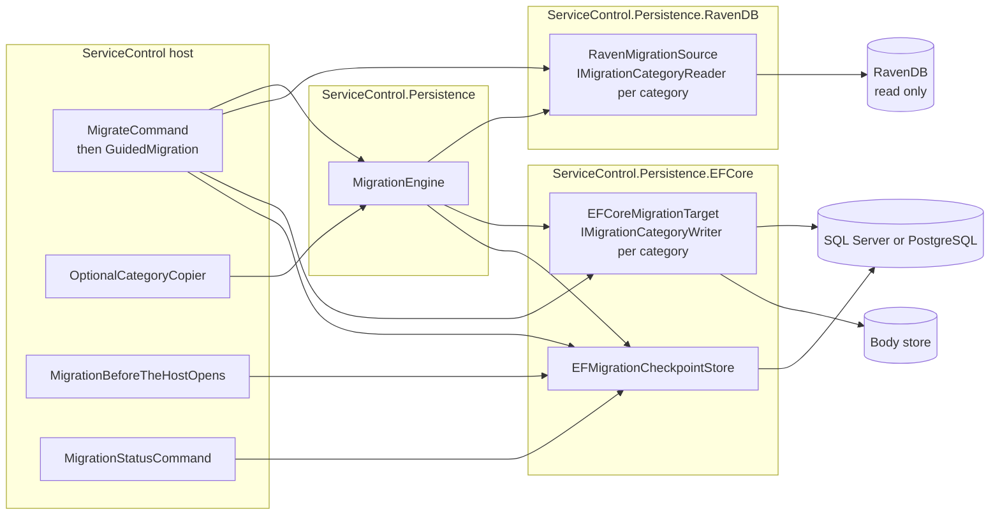

# Migration Engine: System Architecture Design

> [!NOTE]
> This build does not carry the whole migration yet. This page describes it as it will be when it ships.

[The overview](ravendb-to-sql-migration-overview.md) covers behaviour and guarantees. [The instructions](ravendb-to-sql-migration-instructions.md) cover the operator procedure. This page maps both onto types, call order and assembly boundaries.

> [!IMPORTANT]
> Startup check order and category order are load-bearing. Read the required copy and category sections before reordering checks or adding a category.

## Overview



`MigrationEngine` is store-agnostic. It drives `IMigrationSource` and `IMigrationTarget` per category and treats the cursor as an opaque string that it hands from source to target. Progress is persisted per category as a checkpoint row in the target database, committed in the same transaction as the rows it describes. Both migration commands read the checkpoint table.

## Assemblies

Dependencies point inward: each persister knows only its own store, the neutral assembly knows neither, and the host is the only composition root that names both.

| Assembly | Types | Boundary rationale |
| --- | --- | --- |
| `ServiceControl.Persistence` | `MigrationEngine`, `MigrationBodyLoader`. Contracts: `IMigrationSource`, `IMigrationTarget`, `IMigrationCheckpointStore`, `IMigrationStartupCheck`, `IMigrationTargetReadiness`, `IMigrationSourceFactory`. Data: `MigrationCategory`, `MigrationCategoryKind`, `MigrationCategoryIds`, `MigrationCategoryRegistry`, `MigrationBatch`, `MigrationRow`, `MigrationBody`, `MigrationCheckpoint`, `MigrationWriteResult`, `MigrationSkipReason`, `MigrationSkippedRow`, `MigrationSettingValue`. Rules: `MigrationCategoryStateExtensions`, `MigrationSkipReasonExtensions`, `MigrationCheckpointRules`, `HaltThreshold`. Options: `MigrationEngineOptions`, `MigrationSettings`. `MigrationCheckpointConflictException`. Read-only views: `MigrationStatusView`, `MigrationVerification` | Referenced by both persisters and the host, references neither persister, so the engine is unit-tested against in-memory fakes in `ServiceControl.UnitTests/Migration` |
| `ServiceControl.Persistence.RavenDB` | `RavenMigrationSource`, `RavenReadOnlySourceLifecycle`, `RavenDocumentStream`, `IMigrationCategoryReader`, `IWindowedMigrationCategoryReader`, one reader per category | Owns document id prefixes, sessions and the embedded server |
| `ServiceControl.Persistence.EFCore` | `EFCoreMigrationTarget`, `EFCoreMigrationTargetReadiness`, `IMigrationCategoryWriter`, `IStoreKeyedCategoryWriter`, one writer per category, `PreparedBatch`, `IMigrationSqlDialect`, `MigrationInsert`, `StoreKeyedInsert`, `EFMigrationCheckpointStore`, `MigrationCheckpointExtensions`, and the three target readiness checks | Owns tables, column widths and provider parameter limits |
| `ServiceControl` (host) | `MigrateCommand`, `GuidedMigration` with its steps, `MigrationRun`, `MigrationConsole` and `CopyProgress` in `Migration/Guided`, `MigrationBeforeTheHostOpens`, `RecordHostOpenedOnTarget`, `MigrationStartup` with nested `ClosedWindowProgress`, `MigrationStartupCheckRunner`, the two host checks, `OptionalCategoryCopier`, `FinishedCopyBeforeAnIngestionNodeOpens`, `MigrationStatusCommand`, `MigrationCommandHost`, `MigrationOperatorCommands`, `PersistenceFactory.CreateMigrationSource` and `OpenMigrationSource` | Pair support is the one question neither persister can answer, so it lives here |

Supporting assemblies:

- `SqlServerMigrationSqlDialect` and `PostgreSqlMigrationSqlDialect` implement `IMigrationSqlDialect` and are the only provider-specific migration code. SQL Server reads key-column collations in `Open`, builds each key column's `KeyComparer` from the collation's comparison style (case, accent, kana type and width, plus SQL Server's trailing-space padding), and inserts with `MERGE ... WITH (HOLDLOCK)`, de-duplicating the batch with `ROW_NUMBER() OVER (PARTITION BY <key> COLLATE <column collation>)`. PostgreSQL uses `INSERT ... ON CONFLICT DO NOTHING RETURNING`. Both implement `AddLicensingEndpointThroughput`, which groups each statement's rows by key and sums their counts before adding them to the stored day, so the database decides which names are one day. SQL Server groups under the key column's collation; PostgreSQL's deterministic collations make a plain `GROUP BY` the same equality. Each provider assembly carries its own `AddMigrationCheckpoints` EF migration and model snapshot, so a checkpoint schema change needs a migration in both.
- `MigrationProgressReporter` is in the host, and `MigrationStarted`, `MigrationCategoryHalted`, `MigrationFinished` and `MigrationSourceUnreachable` are in `ServiceControl.DomainEvents`.

The RavenDB persister registers no `IMigrationTarget`, `IMigrationTargetReadiness` or `IMigrationCheckpointStore`, so the guards below resolve `null` on RavenDB and return. `MigrationPairIsSupportedCheck` is what rejects RavenDB as a target.

## What runs on every SQL instance

- **Registrations.** `BasePersistence.RegisterDataStores`, reached through each provider's `AddPersistence`, registers `IMigrationCheckpointStore` as `EFMigrationCheckpointStore`, `IMigrationTargetReadiness` as `EFCoreMigrationTargetReadiness` and `IMigrationTarget` as `EFCoreMigrationTarget`, all singletons.
- **`MigrationBeforeTheHostOpens`.** `RunCommand` registers a lifecycle service that checks required checkpoints in `StartingAsync`, before any hosted service starts or Kestrel binds. It delegates to `FinishedCopyBeforeAnIngestionNodeOpens`, treating unknown ids as required. An unfinished required row refuses startup and names `--start-data-migration`. The service never copies data. With no checkpoint store registered (RavenDB), it returns immediately.
- **`FinishedCopyBeforeAnIngestionNodeOpens`.** Registered by `ErrorIngestionOnlyCommand.BuildHost` on every ingestion-only host and by `ImportFailedErrorsCommand.BuildHost` on every SQL import. In `StartingAsync` it reads every checkpoint row, drops the rows the registry classifies as optional, and refuses unless every remaining row `IsFinished`. A required category with no row does not refuse on its own, so a later build that adds a required category does not stop an instance whose migration finished. An id unknown to this build counts as required. The worker never copies: a single host owns the copy, because a second copier would race the offline command on the checkpoint version.
- **`RecordHostOpenedOnTarget` on every writer.** The main host, ingestion workers, and SQL imports register `RecordHostOpenedOnTarget` and stamp `Migration/HostOpenedOnTarget` when checkpoint rows exist. Ingestion ends the free abort, so rollback advice must never offer a free abort after a worker has written.

The ingestion gate sees categories the copy never reached because `CopyStep` upserts a `NotStarted` row for every category in `ToCopy` without one before the first copy pass. `MigrationEngine.RunCategories` does the same for the background copy. Without those rows, a copy interrupted between two categories leaves only terminal rows and the gate passes. The gate cannot see a copy that has not written its first row, see [open decisions](ravendb-to-sql-migration-overview.md#gaps-nothing-enforces).

> [!IMPORTANT]
> Stop workers before running `--start-data-migration`. Restart them only after the command succeeds and the main host opens. A worker cannot detect a migration before its first checkpoint exists.

## The required copy

Unresolved and retry-issued failed messages copy while the host is closed because the copy cannot merge with live writes. `FailedMessagesWriterBase` inserts only messages the target lacks and never updates one it holds. From the moment the host opens, ingestion writes to the same rows:

- **A retry confirmation finds no row.** `ResolveRetriedMessages` updates only rows already in SQL, and `FailedMessageBatchWriter.ResolveRetried` deletes the retry claim either way. The copy then inserts the message as still failing, though its retry succeeded.
- **A message that fails again loses its history.** Ingestion upserts a row holding only the new attempt. The copy then finds the id present and drops the RavenDB row, with its earlier attempts, first failure time and retry-issued status.
- **Group actions see part of the list.** Retrying or archiving a group in ServicePulse acts only on the messages copied so far.

Archived and resolved messages are safe to copy after the host opens. If one of them fails again, the live unresolved row should win, and an insert-only copy gives exactly that. Copying unresolved messages in the background would need a writer that merges by attempt time, and retry confirmations held until their row arrives. Both change live ingestion.

```mermaid
sequenceDiagram
    participant Run as Operator
    participant Copy as MigrateCommand
    participant Guided as GuidedMigration
    participant Checks as MigrationStartupCheckRunner
    participant Source as RavenMigrationSource
    participant Target as EFCoreMigrationTarget
    participant Engine as MigrationEngine

    Run->>Copy: --start-data-migration, with ServiceControl stopped
    Copy->>Checks: MigrationPairIsSupportedCheck
    Copy->>Copy: build persistence-only host; never StartAsync
    Copy->>Copy: PersistenceFactory.CreateMigrationSource, not connected
    Copy->>Guided: Run(MigrationRun)
    Guided->>Guided: confirm stopped, MigrationEngineOptions.ForRequiredCopy
    Guided->>Guided: ConfigurationStep: print the settings, "Is this correct?"
    Guided->>Checks: ChecksStep: host and target checks
    Checks->>Target: Open
    Guided->>Guided: IMigrationCheckpointStore.ReadAll decides the run state
    Guided->>Source: Open, then source.ContributedChecks(), empty for RavenDB
    Guided->>Source: RowsToCopyStep: Count per unfinished required category
    Guided->>Guided: StartTheCopyStep: "Start the copy?"
    Guided->>Engine: CopyStep: seed rows, pending abandons, SourceTotal, RunRequiredCategories
    Engine-->>Guided: one checkpoint per category
    Guided->>Guided: FailedCategoriesStep: retry, abandon or stop
    Guided->>Guided: VerifyStep
    Guided-->>Copy: exit code 0, 1 or 2, or throws and the command exits 1
    Copy-->>Run: on 0: start ServiceControl
    Run->>Run: start service or container
    Note over Run: Startup checks required checkpoints; StartedAsync stamps the target
```

Each position in the sequence is deliberate:

1. **Inside the offline command.** When the command is `MigrateCommand` and `--help` is not given, `Program` configures NLog for this process with a file target only: `migration-<yyyy-MM-dd-HHmmss>.txt` in the log folder for each run, opened for append, so a run started in the same second as the one before adds to its file (`LoggingConfigurator.CreateMigrationLogFile`). An argument `Execute` then refuses prints the reason and names no log file, and the file it leaves holds only a few startup lines. In a container the log goes to the console. `MigrateCommand` parses `GuidedMigrationArguments` first, so an invalid argument fails before step 1. It builds a host containing persistence, logging, and the clock. It never calls `StartAsync` or `RunAsync`, so no hosted services run. It builds a `MigrationRun` over `MigrationConsole.System()` and calls `GuidedMigration.Run`, whose result is the exit code. A step that refuses throws, and `MigrateCommand.Finish` logs the error with its stack, prints it, exits 1, and names the log file last. It names the log file for every outcome, a no at the first question included. `MigrateCommand.Run(settings, customize, cancellationToken)`, which the acceptance tests call, runs with `GuidedMigrationArguments.Unattended`. Ctrl+C cancels the command; committed batches remain resumable through another `--start-data-migration` invocation. The Windows service is not starting during this work, so its start timeout does not apply.
2. **`MigrationPairIsSupportedCheck` first.** It needs no source, target or options. It resolves `PersistenceType` through `PersistenceManifestLibrary` and checks it against `PersistenceFactory.SqlPersistenceNames`; the source type is fixed at `PersistenceFactory.MigrationSourcePersistenceType`. `--start-data-migration` against a RavenDB target is rejected here. `MigrateCommand.Run` runs it before it builds the host, and `ChecksStep` runs it again to print its line.
3. **`PersistenceFactory.CreateMigrationSource`** resolves the source persistence and hard-casts its configuration to `IMigrationSourceFactory`, implemented only by `RavenPersistenceConfiguration`. A non-implementing persister fails with `InvalidCastException`. No I/O happens yet.
4. **`GuidedMigration.Run`** asks the operator to confirm that ServiceControl and every ingestion worker are stopped, then runs `MigrationEngineOptions.ForRequiredCopy`, which reads the halt thresholds and selects no optional category. It walks a fixed list of `IMigrationStep`, numbering only those whose `AppliesTo` is true for the `MigrationRunState` that `ChecksStep` finds: `FirstRun` (no checkpoint row), `Resume`, or `RequiredSettled`. A step returns an exit code to end the run, or null to go on. `MigrationConsole` carries every prompt: yes or no reads `[y/N]`, and with no console input a prompt throws naming `--non-interactive` instead of waiting.
5. **`ConfigurationStep`** prints `IMigrationSource.Configuration` and `IMigrationTargetReadiness.Configuration`, each `MigrationSettingValue` with its origin, and opens nothing. A connection string's secrets are masked by `MigrationSettingValue.MaskSecrets`.
6. **`ChecksStep`**, in order, one `[ok]`, `[FAIL]` or `[skip]` line each:
   - `MigrationPairIsSupportedCheck`.
   - `RetryHistoryDepthIsSafeCheck` is host-owned because it needs only `Settings.RetryHistoryDepth`, which keeps that value off `PersistenceSettings` and out of `/api/configuration`.
   - `EFCoreMigrationTargetReadiness.ContributedChecks`: `SchemaIsCurrentCheck`, `TargetHoldsNoServiceControlDataCheck`, `BodyStorageIsWritableCheck`. The body probe is deleted after writing, so it does not skew body counts.
   - "the migration target opens": `IMigrationTarget.Open`, where the SQL Server dialect loads key-column collations.

   The first refusal prints `[FAIL]`, prints `[skip]` for every check after it and for the source, and throws. Then `ChecksStep` reads the checkpoint rows. It builds the engine, sets `MigrationRun.ToCopy` to the required categories both sides support, and sets the run state.
7. **`TargetHoldsNoServiceControlDataCheck`** passes immediately if a checkpoint row exists for any required category. Otherwise it refuses if any mapped table other than `MigrationCheckpoints` has a row, `Settings` included, naming tables by `GetTableName()` (`endpoint_settings`, `settings` on PostgreSQL).
8. **Source open, last.** It is the only step that can spawn a process. `ChecksStep` reads the checkpoint rows and builds the engine first. `RavenReadOnlySourceLifecycle.Open` then:
   - starts the embedded server, if configured;
   - connects: on an external server it rejects an expired or not-yet-valid client certificate and an `https://` URL without one, then attaches `RefuseWrite` to the request pipeline before `Initialize`, so the version request is covered;
   - checks an external server's version against the client;
   - waits for both databases, with a 5-minute budget per database on an embedded server. The budget is only checked when RavenDB raises its own timeout, so the wait can exceed it.

   > [!IMPORTANT]
   > Readers must stream by id prefix, load by id, or query a static index. `RefuseWrite` blocks writes but passes query POSTs (`/queries`, `/multi_get`, `/streams/queries`), and a dynamic query creates an `Auto/` index. Only the embedded server sets `DisableAutoIndexes`.
9. **Source outage tolerance.** A failed source open is tolerated only in a `RequiredSettled` run. The check prints `[skip]` with the cause and the run logs it. It writes no checkpoint row. `VerifyStep` then skips the report and the run exits 2. The operator can then start ServiceControl; its online copier handles any later source outage independently. In every other case the check prints `[FAIL]` and the run refuses and writes nothing. The refusal adds `MigrationStartup.NoWayOutWithoutTheSource`: RavenDB must be restored to finish the migration, and pointing back at RavenDB or starting over loses nothing ServiceControl has served.
10. **`source.ContributedChecks()`** runs once the source is open, because such a check needs a session. `RavenMigrationSource` returns none, and a refusal here is never tolerated.
11. **`RowsToCopyStep`** counts each category in `ToCopy` that is not finished through `IMigrationSource.Count`, and keeps the counts in `MigrationRun.Counts` for the copy and verify. It prints each category's name before its count, so a count that waits on a RavenDB index shows which category it is on. `FailedMessagesReader.Count` counts through `FailedMessageViewIndex`, and reads every row when the index cannot be trusted. On a first run above `RowsToCopyStep.LargeCategoryLimit` (50,000) unresolved failed messages, it warns, advises setting `PersistenceType` back to RavenDB to archive or resolve them first, and offers stop, continue or abandon. A resume shows no warning and keeps the answer the first run gave, but still adds the category to `PendingAbandons` when `--abandon` names it and its copy has not started. A non-interactive run throws there unless `--abandon=UnresolvedAndRetryIssuedFailedMessages` is given. An abandon goes into `MigrationRun.PendingAbandons`, so nothing is written yet.
12. **No optional categories.** The offline command selects, saves and sets nothing for the optional categories. ServicePulse starts them after the host opens.
13. **`StartTheCopyStep`**, on a first run only, asks "Start the copy?". No migration data is written before this answer.
14. **`CopyStep`** writes, in this order:
    - a `NotStarted` row for each category in `ToCopy` without one, so startup can detect a copy interrupted between categories;
    - each pending abandon, through `FailedCategoriesStep.Abandon` and `MigrationOperatorCommands.ApplyAbandon`;
    - `SourceTotal` from the rows step's count on each counted category.

    `CopyStep.CopyPass` then runs `MigrationStartup.RunRequiredCategories`, which runs each required category under its own linked `CancellationTokenSource`, awaited with `WaitAsync` on that token. It polls the checkpoint store every second for `CopyProgress`, and at the end of the pass prints this pass's fault skips with category, source id and reason from `MigrationEngine.SkippedThisRun`, and its harmless skips as counts from `BenignSkipsThisRun`. It subtracts what earlier passes added to those two and to `MergedAndChangedThisRun`, so a copy again in the failed categories step reports only its own skips, merges and changes. With no Failed category, `CopyStep` calls `RefuseIfAnyCategoryDidNotComplete`.
15. **`ClosedWindowProgress`** polls the checkpoint store every 30 seconds and logs progress. When the running category has committed nothing for 30 minutes, measured from the later of `LastProgressAt` and its run start, it cancels that category's token. `WaitAsync` returns even if the call underneath ignores cancellation, the category settles `Halted` with the stall in `LastError`, and the next category runs. The abandoned call keeps running until the process exits. A host shutdown leaves the row `InProgress`.
16. **`CopyOrExplainWhyItStopped`** maps `MigrationCheckpointConflictException` to a message about a second instance writing the same checkpoints.
17. **`ReportWhatTheCopyLeftBehind`** logs skips per category. It names `--start-data-migration --retry=<category>` only for an `IsFailed` row, and reports harmless skips on a `Complete` row with the explanation `HarmlessSkipExplanations` holds for each harmless reason. A test fails unless that map covers exactly the `IsBenign` reasons.
18. **`FailedCategoriesStep`** runs when the copy pass left a required category Failed. For each, a `--retry=` argument is used once per run and a `--abandon=` argument applies without a prompt. Otherwise an interactive run asks retry, abandon or stop, and a non-interactive run does nothing. Abandon asks the operator to type `ABANDON` after naming the dependants it also takes. A pass that changed something runs `CopyPass` again. A pass that changed nothing calls `RefuseIfAnyCategoryDidNotComplete`. A retry the target refuses with `InvalidOperationException` is printed and the choice is asked again.
19. **`RefuseIfAnyCategoryDidNotComplete`** keeps the host closed. One message lists every Failed required category with stored state, counts, skips by reason (permanent reasons flagged as not retryable through `IsPermanent`, and harmless reasons flagged `, harmless` through `IsBenign`), `LastError` and both arguments. A Copying required category gets a line without a command. Rollback advice comes last.
20. **`VerifyStep`** prints the verification report and sets the exit code (see [Commands](#commands)). In a run that copied, it uses `MigrationRun.Counts` instead of counting again. It judges the required categories only.
21. **`RecordHostOpenedOnTarget`** is registered on normal startup, never on the offline command. In `StartedAsync` it writes `Migration/HostOpenedOnTarget` the first time a host opens on a database that holds checkpoint rows, so the marker means "a host opened since the copy began", not "a host ran here once". The marker ends the free abort.

## The background copy

`OptionalCategoryCopier` is a `BackgroundService` registered by `RunCommand` only on the main instance. It waits for `ApplicationStarted`, then runs each optional category that ServicePulse started and that is not finished. With none, it creates no source and opens no target until ServicePulse starts one.

- It runs the started, supported optional categories in registry order, `EventLog` then `ArchivedAndResolvedFailedMessages`, skipping rows that are `IsFinished` or `IsFailed`.
- It creates and opens its own source only when a supported category is still copying. On failure it calls `RecordSourceOutage` and exits for this start. It does not depend on in-process state from `--start-data-migration`, which ran in another process.
- An exception leaves the category `InProgress` with `LastError`, untouched until the next start, so a transient failure never forces an abandon.

Windowing: ServicePulse supplies the window when it starts a category, and it is saved as `StartedWindowSeconds`. The reader applies it through `IWindowedMigrationCategoryReader`. `CopiesFrom` is `StartedAt` minus the saved window.

`Migration/ThrottlePauseMilliseconds` inserts a delay between optional-category batches, skipping the first batch of each category. Required categories are never throttled.

## Copying a batch

`MigrationEngine.RunCategoryAsync` is the per-category loop. Every store-specific step is delegated.

| Step | Owner | Rationale |
| --- | --- | --- |
| Load the checkpoint | `EFMigrationCheckpointStore.Read` | The table lives in the target database |
| Short-circuit terminal or Failed rows | `MigrationCategoryStateExtensions.IsFinished`, `IsFailed` | Single definition shared by every caller; the source is not read |
| Ordering | `MigrationCategory.MustFollow`, from `MigrationCategoryRegistry.All` | Data, not code. A follower whose predecessor is not `IsFinished` is upserted `Blocked` with `LastError` naming it |
| Start or resume | Engine: `NotStarted`, `Blocked`, or any row with `LastError` moves to `InProgress`, cursor kept | `Halted` never resumes by itself; only a retry in `--start-data-migration` resets it |
| Batch size | `EFCoreMigrationTarget.BatchSizeFor` via the category's `IMigrationCategoryWriter` | Writers use `RowsPerStatementFor<TEntity>` from the dialect's parameter budget; `StoreKeyedInsert`-only writers use a fixed 500 |
| Read after cursor | `IMigrationCategoryReader`, usually via `RavenDocumentStream.ByPrefix`; `FailedMessagesReader` streams a query on `FailedMessageViewIndex` ordered by `id()`, after waiting for the index to be up to date, and falls back to `ByPrefix` when the index is errored, disabled or holds fewer failed messages with a copied status than the collection does; the two licensing endpoint readers use `ThroughputDocuments.Endpoints`; single-document readers load by id | No-tracking session. A cursor whose document no longer exists is refused, because RavenDB would otherwise resume after the missing id and skip rows. The cursor advances on every document seen. Both unresolved paths resume on the same document id cursor |
| Fetch bodies | `MigrationBodyLoader` over `IMigrationSource.ReadBody` | Rows with a null body only, 8 concurrent, `MigrationEngine.MaxBodyReadAttempts` (3) with `MigrationEngineOptions.BodyRetryBackoff` (200 ms). `IsDefect` exceptions such as `NotSupportedException` are not retried and reach the batch catch. A missing attachment is skipped as `BodyMissing` after one attempt, a permanent fault no retry fixes, since ingestion writes an attachment for every failed message. Body skips stay off the checkpoint until the write commits |
| Map documents to rows | `IMigrationCategoryWriter.Prepare`, returning `PreparedBatch` | Only the writer knows `NOT NULL` columns, key caps and what the product deletes anyway. Rows are inserted later inside the target transaction. Body-carrying writers write external bodies here, before the transaction, only for messages the target does not hold. A crash leaves orphan bodies, see [open decisions](ravendb-to-sql-migration-overview.md#what-the-checks-do-not-catch) |
| Insert and checkpoint | `EFCoreMigrationTarget.Write`: `AccountForEveryRow`, then in one transaction under the execution strategy `PreparedBatch.Insert`, `AlreadyPresentIn`, `MigrationCheckpoint.Extend`, `MigrationCheckpointExtensions.UpsertCheckpoint` | Most writers use the dialect's `InsertMissing` built on `MigrationInsert`. Store-keyed rows use `StoreKeyedInsert`, because `MigrationInsert` rejects store-generated keys. Throughput days use `AddLicensingEndpointThroughput`. Each attempt clears the change tracker. Skips, merges and changes are logged after commit. `MigrationWriteResult.Merged` and `Changed` carry the batch's counts of each, which the engine adds up per category for the current run in `MigrationEngine.MergedAndChangedThisRun`; the checkpoint stores neither. See [progress and checkpoints](ravendb-to-sql-migration-overview.md#progress-and-checkpoints) |
| Post-commit reconciliation | Engine compares `Write`'s saved checkpoint with the counts it restated | Mismatch settles `Halted`, either kind |
| Early stop | `HaltThreshold.Exceeded` on per-run counters | Fault skips (reasons not `IsBenign`, plus body skips) must exceed both `Migration/HaltThresholdPercent` and `Migration/HaltThresholdMinimum`. Counters are not persisted, so the threshold is per run |
| Settle | `MigrationEngine.Settle` at the end of the source | Saves the row in its settled state. A halt logs before saving, because the checkpoint store shares the target database and a failed save would hide the cause |

Failed message body placement lives in `FailedMessagesWriter`, shared by `ArchivedAndResolvedFailedMessagesWriter`. `MessageBodyClassifier.Classify` decides placement and `FailedMessageDocumentTranslator.SetBody` fills the columns: text up to `MaxBodySizeToStore` (100 KB default) inline; longer text inline prefix plus external copy; binary, invalid UTF-8 or NUL-containing text external only; empty bodies not stored. External writes go through `IBodyStoragePersistence.WriteBody`, which owns compression and the filesystem, Azure Blob or S3 backend, and complete before the transaction opens. `FailedErrorImportsWriter` places a failed error import's body by the SQL import store's own rule, inline up to `MaxBodySizeToStore` and otherwise external only, under `FailedErrorImportEntity.ExternalBodyId`, also before the transaction opens.

Invariants enforced across class boundaries:

- `MigrationCheckpoint.Extend` throws unless the per-`MigrationSkipReason` counts sum exactly to the skipped count. `EFCoreMigrationTarget.AccountForEveryRow` throws unless prepared rows plus skips equal the batch size, catching rows dropped during preparation. `AlreadyPresentIn` throws when a writer over-reports. Every row is copied, skipped or already present.
- `MigrationSkipReasonExtensions.IsBenign` is fixed: `PastRetention`, `BlankGroupComment`, `SourceStorageCheck`. Everything else is a fault, `Unknown` included.
- `PreparedBatch.Merges` reports rows whose key collides with another under the target's collation. Writers with a text key detect them with `KeyMerges.In` or `KeyMerges.Split`, which compare with `IMigrationSqlDialect.KeyComparer` against the batch and the existing table. A row the table holds exactly is a re-read, not a merge, unless another source row stored it while this process ran: each writer remembers that in `MigrationCategoryWriter.KeyWriters`, so a key repeated across two batches is a merge. After a restart the writer remembers nothing, so a repeat that straddles the restart counts as already present. `FailedErrorImportsWriter`, whose key is a GUID, reports a second import of the same message in the batch, and one the table holds with another failure time. `EFCoreMigrationTarget` logs one warning per merge naming both keys, the source row kept, or the stored row, and the source row dropped. The dropped row counts as already present, and also in `MigrationWriteResult.Merged`, so the category summary `MigrationStartup.ReportWhatTheCopyLeftBehind` logs shows merges apart from the rest of already present. Every writer whose key can fold two source rows into one reports them here, or the summary understates merges.
- `PreparedBatch.Changes` reports rows the insert adds whose stored value differs from the source's on purpose: a failed message's cut message type, dropped or blank failure groups, and failure groups one key folds together; a failed error import's missing exception or body stored empty; and a group comment on a group with no copied failed message, which the retention sweep deletes. A failed message keeping only its newest processing attempt is not a change, because every row does that by design. Writers report only rows the target does not already hold, so a re-read reports nothing twice. `EFCoreMigrationTarget` logs one warning per change after the commit, and `MigrationWriteResult.Changed` counts them. A process that stops between the commit and the log loses that batch's lines for good. `MigrationStartup.ReportWhatTheCopyLeftBehind` warns, naming both counts, when a category's merged count exceeds its already-present count, because the key comparer then disagrees with the database. `PreparedBatch.RenumberedRows` names rows the database gives new ids, and the target logs it once per copy of a category, on the batch whose checkpoint has copied nothing yet.

## Category states

`MigrationCategoryState` has seven stored values, surfaced as four operator states:

| Operator state | Stored | Meaning |
| --- | --- | --- |
| Copying | `NotStarted`, `InProgress`, `Blocked` | Not terminal, including a follower waiting on its predecessor and an optional category stopped by an error the next start retries |
| Done | `Complete` | Every row copied or benignly skipped, counts reconciled |
| Failed | `Halted`, `CompleteWithErrors` | Stays Failed until it is retried or abandoned |
| Abandoned | `Abandoned` | Terminal, set by the operator directly or by cascade |

The required-copy refusal prints both forms for a Failed row (`EndpointSettings is Failed (Halted)`) and the stored state alone for a Copying row. Retry and abandon refusals print the operator state only.

Early stops during a run:

- Threshold exceeded or post-commit mismatch: `Halted`, either kind.
- Required category exception or 30-minute stall: `Halted`.
- Optional category exception: stays `InProgress` with `LastError`.

Settlement at end of source, in order:

1. Rows read this run differ from rows processed: `Halted`.
2. Any fault skip in the checkpoint: `CompleteWithErrors`.
3. Otherwise: `Complete`.

`MigrationCategoryStateExtensions.IsFinished` (`Complete` or `Abandoned`) and `IsFailed` (`Halted` or `CompleteWithErrors`) are the single definitions, used by the engine, the required-copy refusal, the background copier, the end-of-migration guard, the ingestion gate, status, verify, and retry and abandon. The host opens when every required category `IsFinished`; the migration is finished when every category is.

`MigrationCheckpointRules` holds the rules shared by status, verify, retry and abandon:

- `IsOutstanding`: not finished, except an optional `NotStarted` row that ServicePulse has not started.
- `CanBeRetried`: an `IsFailed` row. Never a missing row.
- `CanBeAbandoned`: any category in any state except `Complete` or `Abandoned`, including no row.

Checkpoint schema: one row per category in `MigrationCheckpoints` (`migration_checkpoints` on PostgreSQL), primary key `CategoryId`. Columns: `State`, `Cursor`, `CopiedCount`, `SkippedCount`, `AlreadyPresentCount`, `SkipReasons` (JSON keyed by enum name; unknown names deserialize to `Unknown`, a fault), `StartedAt`, `LastProgressAt`, `SettledAt`, `LastError`, `StartedWindowSeconds`, `SourceTotal` and `Version`, the optimistic concurrency token. `CopyStep` writes `SourceTotal` from the rows step's count before the copy, and `CopyProgress` and `--migration-status` show a percentage from it. The engine never counts the source. No attempt counter and no decision record. The checkpoint does not store merged or changed counts: `MigrationEngine.MergedAndChangedThisRun` holds them for the current run only, so the summary of a resumed category counts only that run's, and `CopyStep.CopyPass` subtracts earlier passes, so each pass's summary counts only its own. Run-level facts are `Settings` rows under `Migration/`, such as `Migration/HostOpenedOnTarget`.

## Commands

Both migration commands build a host with `AddPersistence` through `MigrationCommandHost.CreateBuilder` and never call `StartAsync`, so no hosted service runs, including the retention sweeper and the integration event dispatcher.

| Command | Class | Opens RavenDB | Reads and writes |
| --- | --- | --- | --- |
| `--start-data-migration` | `MigrateCommand`, `GuidedMigration` and the steps in `Migration/Guided` | Yes, except a `RequiredSettled` run whose source does not open | Runs the steps above. Takes `--non-interactive`, `--abandon=<category>` and `--retry=<category>`, parsed and validated by `GuidedMigrationArguments`; `--abandon` and `--retry` take only a required category. Writes nothing before "Start the copy?" except the body probe. Exit code 0 when verify is clean; 1 when the operator answered no or stopped, a check refused, a category is Failed, verify found a category `INCOMPLETE`, a run with no console stopped at the large-category warning, or the run was cancelled; 2 when nothing is outstanding but verify found `ROWS NOT READ`, or verify was skipped because the source did not open. It never starts the service itself |
| `--migration-status` | `MigrationStatusCommand`, `MigrationStatusView` | No | `IMigrationCheckpointStore.ReadAll`, without opening the target. A category with no row, or a `NotStarted` row the copy has not reached, reads `Not started`. Its `Done` column is the share of `SourceTotal` the copy is finished with, blank for a category that was not counted or was abandoned. `MigrationCategoryStatus.NextCommands` names `--start-data-migration --retry=<category>` or `--abandon=<category>` for a Failed required category only. Read-only, safe while ServiceControl runs. A persistence with no checkpoint store is refused in one line with exit code 1 |

`VerifyStep.Report` reads `ReadAll`, then takes `IMigrationSource.Count` for each required category the source lists in `SupportedCategoryIds`, judged against the rows the copy read (below). In a run that copied, a category the rows step counted is not counted again. It never counts or judges an optional category, so the closing line says every required category is Done or Abandoned. Any other finished row reads `NOT COUNTED`. A row whose id the registry does not know is judged as required, as status judges it. Never calls `IMigrationTarget.Count`. Streams every counted category, though not the bodies. Its exit code is 1 while a required category `IsOutstanding` or has no row, otherwise 2 when a category reads `ROWS NOT READ`, and 0 when none does; skipped rows and `ABANDONED` are listed but do not change it.

`MigrationOperatorCommands.Retry` builds the reset row without I/O: state `NotStarted`; `Cursor`, `CopiedCount`, `SkippedCount`, `AlreadyPresentCount`, `SkipReasons`, `SettledAt` and `LastError` cleared; `StartedAt` and `StartedWindowSeconds` kept. Change retry semantics there. `MigrationOperatorCommands.ApplyRetry` reads the row and hands the reset to `IMigrationTarget.ResetForRetry`, which persists it in one transaction under the execution strategy. A category whose rows a re-read cannot recognise as already copied cannot be re-read idempotently: store-keyed rows come back under new keys, and throughput counts are added again. Its writer implements `IStoreKeyedCategoryWriter.DeleteCopiedRows` and the reset deletes its rows in the same transaction:

- `RetryOperationsWriter`: `HistoricRetryOperations`, then `UnacknowledgedRetryOperations`.
- `PendingIntegrationEventsWriter`: `ExternalIntegrationDispatchRequests`.
- `LicensingThroughputWriter`: `LicensingEndpointThroughput`.

All three are required categories, and `CanBeRetried` takes a category only when it is Failed, which for a required category keeps the host closed, so the host has not opened and the target started empty. `ResetForRetry` also checks this itself: inside the reset transaction it reads the `Migration/HostOpenedOnTarget` setting, and when it is set it refuses a reset that would delete, naming the category, and deletes and saves nothing. Its message offers `--start-data-migration --abandon=<category>`. A reset that deletes nothing, such as an optional category's, is not refused. `EventLog` is also store-keyed but copies after the host opens, when its rows are indistinguishable from live ones. So it is abandon-only, and `MigrationOperatorCommands.Retry` rejects it.

`MigrationOperatorCommands.ApplyAbandon` first re-saves the named row unchanged, when it exists, to bump its version and fence off a concurrent copy. It then abandons dependants along `MigrationCategory.MustFollowIsDataLink` (`EndpointSettings` after `KnownEndpoints`, `LicensingThroughput` after `LicensingEndpoints`), deepest first, skipping `Complete` and `Abandoned` dependants and inserting `Abandoned` rows for dependants without one, and saves the named row last. `GroupComments` follows the unresolved failed messages for ordering only and is not cascaded. An optional category with no row gets a new `Abandoned` row. No domain event is raised, because ServiceControl is stopped. An abandon chosen in the rows step waits in `MigrationRun.PendingAbandons`, and `CopyStep` applies it after seeding the rows and before the first copy pass. Retry and abandon of optional categories have no caller in this build; a later ServicePulse API will call them.

Retry and abandon rely on `MigrationCheckpointConflictException` to detect a race with a running copy.

`MigrationVerification` judges one thing per category: RavenDB now against the rows the copy read, `CopiedCount` plus `SkippedCount` plus `AlreadyPresentCount`. That sum is exactly the rows the last complete pass read, body skips included: `RunCategoryAsync` settles `Halted` when the rows a run read differ from the rows the target accounted for, a crash resume adds to the same totals, and a retry clears them. The migration never writes to RavenDB, because `RefuseWrite` refuses every client write. RavenDB still shrinks through its own expiry, and it can grow or change if ServiceControl runs on it again between two runs of the copy, which the instructions forbid.

- **RavenDB higher than the sum** is rows the copy never read. Verify flags them, by category.
- **RavenDB lower than the sum** is rows RavenDB removed after the copy read them, normal for the event log, the archive and a few unresolved messages with a stale expiry. Printed, not judged.
- **Expiry can hide the same number of unread rows** in the categories it touches, so a flagged number is a floor.
- **The count uses the same reader the copy used** (`RavenMigrationSource.Count`). For unresolved failed messages that reader counts through the index it streams, and reads every row when it falls back. So verify finds rows one run missed, such as a resume that skipped a range or a stream that ended early. It cannot find a reader that always misses the same rows, or a source pointed at the wrong database.
- **No SQL count is compared with anything.** Once the host opens, normal use rewrites most categories' tables within minutes.
- **An abandoned category's sum covers its last pass only.** Rows an earlier pass copied before a retry are not in the sum, so RavenDB minus the sum overstates what was never copied.

For rows never read on a Done category, verify prints `ROWS NOT READ`, names the category under the table and tells the operator to keep RavenDB, because those rows exist only there. They make the exit code 2 when nothing is outstanding, never 1, and neither retry nor abandon takes a Done row. Whether to fix them is an [open decision](ravendb-to-sql-migration-overview.md#what-the-checks-do-not-catch).

## Readers and writers

Readers live at `ServiceControl.Persistence.RavenDB/DataMigration/Readers/<Category>Reader.cs` and are keyed in `RavenMigrationSource`'s reader dictionary. Writers live at `ServiceControl.Persistence.EFCore/DataMigration/Writers/<Category>Writer.cs` and are keyed in the `FrozenDictionary` initialised in `EFCoreMigrationTarget`. `MigrationCategoryCoverageTests` asserts that every registry category has both.

Every reader derives from `MigrationCategoryReader<TDocument>` and every writer from `MigrationCategoryWriter<TDocument>`, and the two for one category take the same `TDocument`, the type of each row's `Document`. The reader base streams whole documents from the primary database through `WholeDocuments`, and exposes `Lifecycle` to a reader that projects or reads the throughput database itself. The writer base casts every row once and hands `PrepareDocuments` the typed documents, so a row of another type fails the batch with an `InvalidCastException` naming the category, the row and both types. Four tests hold this: `MigrationCategoryCoverageTests.Every_reader_and_its_writer_agree_on_the_document_type`, `MigrationCategoryReadersTests.Every_reader_derives_from_the_typed_base`, `MigrationCategoryWritersTests.Every_writer_derives_from_the_typed_base` and `MigrationCategoryWritersTests.Every_writer_names_its_category_and_the_row_when_a_document_is_not_its_type`.

| Order | Category | Kind | Reader, writer | Notes |
| --- | --- | --- | --- | --- |
| 1 | `KnownEndpoints` | Required | `KnownEndpointsReader`, `KnownEndpointsWriter` | |
| 2 | `EndpointSettings` | Required | `EndpointSettingsReader`, `EndpointSettingsWriter` | Data link to `KnownEndpoints`. Copies every setting, including one for an unknown endpoint, which `HeartbeatEndpointSettingsSyncHostedService` removes once the host opens. Reports case merges on a case-insensitive name column |
| 3 | `MessageRedirects` | Required | `MessageRedirectsReader`, `MessageRedirectsWriter` | |
| 4 | `Subscriptions` | Required | `SubscriptionsReader`, `SubscriptionsWriter` | Rows differing only in message-type version merge |
| 5 | `NotificationSettings` | Required | `NotificationSettingsReader`, `NotificationSettingsWriter` | One `Settings` row via `SettingRowMapper` |
| 6 | `TrialEndDate` | Required | `TrialEndDateReader`, `TrialEndDateWriter` | One `Settings` row via `SettingRowMapper` |
| 7 | `RetryOperations` | Required | `RetryOperationsReader`, `RetryOperationsWriter` | Two tables: historic rows store-keyed via `StoreKeyedInsert`, unacknowledged rows via `InsertMissing`, which sizes the batch. Deletes its rows on retry |
| 8 | `LicensingEndpoints` | Required | `LicensingEndpointsReader`, `LicensingEndpointsWriter` | Throughput database. Reads only the `EndpointDocuments` collection, through `ThroughputDocuments.Endpoint`, because the throughput database gives its documents no id prefix and also holds the settings documents. With no prefix RavenDB streams in reverse etag order and ignores `startAfter`, so `ThroughputDocuments.Endpoints` reads every endpoint, sorts the ids in ordinal order and skips past the cursor itself. Reports through `KeyMerges.In` each endpoint folded into another's key. `LicensingThroughputWriter` reports no merge for the days, because the fold is reported here |
| 9 | `LicensingThroughput` | Required | `LicensingThroughputReader`, `LicensingThroughputWriter` | Throughput database. Data link to `LicensingEndpoints`. The reader gives one batch per endpoint from `ThroughputDocuments.Endpoints` with a batch size of one, and ignores the requested batch size, because one endpoint can hold a year or more of days. Each batch's cursor is its endpoint's id. The writer keeps the last row of a day repeated for one source endpoint, compared ordinally. `AddLicensingEndpointThroughput` splits the batch into statements and adds each day's count to the stored one, summing endpoints whose names the key column treats as the same, in one batch or across batches. A re-read is not idempotent, so a resume relies on each batch committing with its checkpoint, and a retry deletes the copied rows first |
| 10 | `LicensingReportMasks` | Required | `LicensingReportMasksReader`, `LicensingReportMasksWriter` | Throughput database. One `Settings` row via `SettingRowMapper` |
| 11 | `LicensedEndpointDetails` | Required | `LicensedEndpointDetailsReader`, `LicensedEndpointDetailsWriter` | Throughput database. One `Settings` row via `SettingRowMapper` |
| 12 | `UnresolvedAndRetryIssuedFailedMessages` | Required | `FailedMessagesReader`, `FailedMessagesWriter` | Carries bodies. `FailedMessageStream` projection, `FailedMessageDocumentTranslator`. `FailedMessageStream.ResolveRetryClaims` looks up each batch's RavenDB retry claims in one request and gives every retry-issued row the `RetryClaimHeld` metadata key. The writer writes a claim only for a retry-issued message it inserts whose flag is true, so the claims mirror RavenDB's, and fails the batch when the flag is missing or not a bool |
| 13 | `PendingIntegrationEvents` | Required | `PendingIntegrationEventsReader`, `PendingIntegrationEventsWriter` | Store-keyed via `StoreKeyedInsert`. Deletes its rows on retry |
| 14 | `CustomChecks` | Required | `CustomChecksReader`, `CustomChecksWriter` | The RavenDB reader flags a check whose id and category match one of the RavenDB persister's own six checks with the `SourceStorageCheck` metadata key, and the writer skips a flagged row as `SourceStorageCheck` without knowing any id. A RavenDB audit instance's dirty memory result reports under another category, so it is copied |
| 15 | `FailedErrorImports` | Required | `FailedErrorImportsReader`, `FailedErrorImportsWriter` | Carries bodies inline in `Read`, never calls `ReadBody` |
| 16 | `GroupComments` | Required | `GroupCommentsReader`, `GroupCommentsWriter` | Ordered after `UnresolvedAndRetryIssuedFailedMessages`, not a data link. Skips blanks as `BlankGroupComment`. Reports group ids that differ only in trailing spaces as merges on SQL Server. Reports each copied comment on a group with no copied failed message as a change, because the retention sweep deletes it |
| 1 | `EventLog` | Optional | `EventLogReader`, `EventLogWriter` | Windowed, store-keyed, abandon-only. Skips as `PastRetention` |
| 2 | `ArchivedAndResolvedFailedMessages` | Optional | `ArchivedAndResolvedFailedMessagesReader`, `ArchivedAndResolvedFailedMessagesWriter` | Windowed, carries bodies, shares `FailedMessagesWriter` preparation. Skips as `PastRetention` |

## Progress reporting

There is no migration custom check. Progress uses the console of `--start-data-migration`, the log and `--migration-status` only. ServicePulse shows migration status in a view of its own and in its activity feed instead.

- `MigrationProgressReporter` raises `MigrationStarted`, `MigrationCategoryHalted` (for both Failed states), `MigrationFinished` (carrying `CategoriesAbandoned`) and `MigrationSourceUnreachable`, mapped into the ServicePulse activity feed by their `EventLogMappingDefinition` classes. It logs and swallows publish failures but propagates cancellation. All four are raised from `OptionalCategoryCopier`, so they cover the background copy only, and a Failed required category produces no activity-feed entry; its record is the console of `--start-data-migration`, the startup refusal and the log.
- `MigrationSourceUnreachable` is raised once per start when `OptionalCategoryCopier` idles on a source outage after its own failed open, carrying the error and the optional categories left waiting.
- Completed checkpoints stop the online copier automatically. No enable setting or final configuration edit is needed.
- `CopyProgress` shows the running required category on the console as rows done, the `SourceTotal` and a percentage. In a console window it redraws one line in place each time `CopyStep` polls the store, once a second. When the output is redirected or the process runs in a container, it prints a new line at every 10%. An abandoned category shows its rows done with no total or percentage, as `--migration-status` does. At the end of each copy pass `CopyStep` prints the fault skips by id and reason, and the harmless skips as counts.
- `ClosedWindowProgress` logs running required categories every 30 seconds while the host is closed, as "copied of total" once `SourceTotal` is set. Outside a container the offline command logs to its own `migration-<yyyy-MM-dd-HHmmss>.txt`, and the online copier logs to `logfile.txt`.
- `--migration-status` reports state, progress with a `Done` percentage from `SourceTotal`, last error and, for a Failed required category, the `--start-data-migration` arguments that retry or abandon it, at any time. For each required category that keeps the host closed, an unfinished row, or no row when rows exist and none is required, it also says that ServiceControl will not start and that only `--start-data-migration` copies it.
